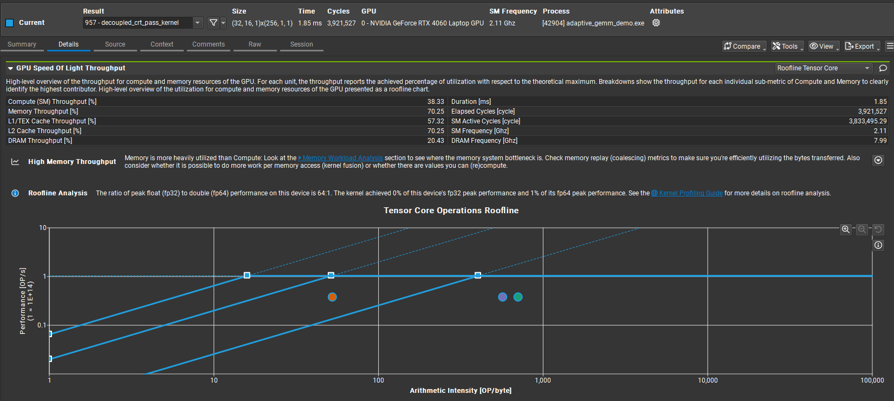
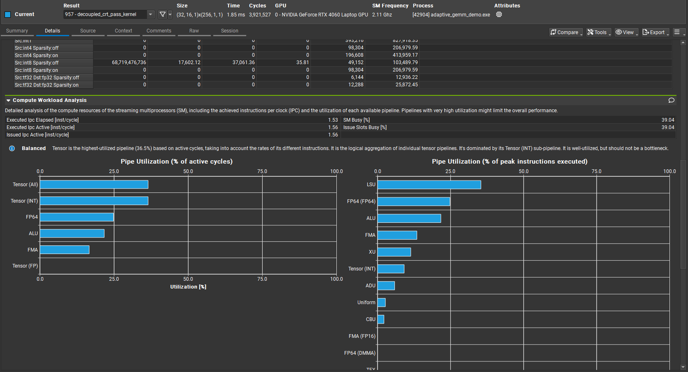

# AdaptiveGEMM: Ozaki GEMM on INT8 Tensor Cores

[](LICENSE)
[](https://developer.nvidia.com/cuda-toolkit)
[](https://isocpp.org/std/the-standard)
[](https://cmake.org/)
[](.github/workflows/ci.yml)

Consumer Ada GPUs throttle native FP64. AdaptiveGEMM maps a 2-slice Ozaki +
7-prime CRT GEMM onto INT8 Tensor Cores. On an RTX 4060 Laptop it is **faster
than native `cublasDgemm`**, and **slower and less accurate than cuBLAS 13
FP64 emulation**. The speedup over native DGEMM is a reduced-precision
tradeoff, not an equivalent FP64 replacement.

**Precision contract:** this library accepts FP64 inputs and writes FP64
outputs, but the default INT8 CRT path does **not** provide FP64-precision
semantics. Default Phase 22 is an experimental ~34-bit mantissa path. On
2048³ `U(-1,1)` inputs it keeps max error around `3e-9`, which is better than
plain FP32 on this benchmark but still far from native DGEMM / cuBLAS emu ulp.
Treat it as FP32-class / FP32-plus accuracy for bounded, well-conditioned
inputs, not as a drop-in FP64 GEMM.

**English** | [**中文**](#中文版)

---

## Why This Exists

Ada consumer cards have no FP64 Tensor Cores. Native DGEMM runs on throttled
CUDA cores. The same SM has unused INT8 Tensor Core throughput, which is the
Ozaki / CRT idea: split the FP64 inputs, multiply in INT8, reconstruct.

CUDA 13 cuBLAS already ships the production version of that idea
(`CUBLAS_COMPUTE_64F_EMULATED_FIXEDPOINT`). This repo is a from-scratch Ada
implementation for reading, profiling, and writing about the kernels — not a
faster library than NVIDIA's.

| Path | RTX 4060 Laptop (measured, 2048³) |
|------|-----------------------------------|
| Native cuBLAS DGEMM | 82.2 ms / 209 GFLOPS |
| AdaptiveGEMM Phase 22 | 13.6 ms / 1262 GFLOPS |
| cuBLAS 13 Ozaki emu | 8.5 ms / 2014 GFLOPS |

A100 numbers do not belong in this table. We did not re-bench A100.

---

## Performance

Measured 2026-08 on **RTX 4060 Laptop (Ada, SM 8.9, CUDA 13.0)**, 2048³,
`U(-1,1)` float64, vs row-major-equivalent native `cublasGemmEx(COMPUTE_64F)`.

| Implementation | Time | Throughput | vs native | Max error vs native FP64 |
|----------------|------|------------|-----------|--------------------------|
| cuBLAS native DGEMM | 82.2 ms | 209 GFLOPS | 1.0× | — |
| **AdaptiveGEMM Phase 22 (INT8 CRT)** | **13.6 ms** | **1262 GFLOPS** | **6.0×** | **3.40e-9** |
| cuBLAS 13 Ozaki emu (`COMPUTE_64F_EMULATED_FIXEDPOINT`) | 8.5 ms | 2014 GFLOPS | 9.6× | 2.84e-13 |
| AdaptiveGEMM Scheme I (2048³ err≤1e-8, backend=intree_f64_epilogue) | ~22.1 ms | ~777 GFLOPS | ~3.7× | ≤1e-8 |
| 孤立 INT8 GEMM vs cublasGemmEx INT8 | — | 22.3 vs ~24.5 TOPS | A1 met | — |
| Old Phase 24 ExtremeMix (default before this fix) | ~130 ms | ~132 GFLOPS | 0.6× | 3.55e-15 |

Phase 22 vs cuBLAS emu: **about 1.6× slower**, error worse by ~4 orders of
magnitude. NVIDIA wins on this card.

The old Phase 24 1e-15 figure was not Ozaki reaching FP64. That path launched a
naive residual FP64 GEMM after the INT8 CRT and effectively recomputed `C`.
It was slower than native DGEMM. Do not use it as the headline number.

Demo default is Phase 22 (`enable_fp64 = false`, `enable_residual = false`).

### What the NCU notes actually measured

Earlier Nsight Compute numbers (`decoupled_crt_pass_kernel` occupancy ~48%,
INT8 tensor pipe ~36%, precompute tiled-layout fix 50 ms → ~9 ms) describe
**the CRT kernel**, not the 130 ms Phase 24 wall time. Residual / naive FP64
GEMMs dominated that end-to-end number.




---

## Accuracy

Phase 22 uses a **17-bit high + 17-bit low** split (about 34 mantissa bits)
and 7 primes `{127, 113, 109, 107, 103, 101, 97}`. That is why the error sits
near `1e-9`, not `1e-15`.

Do not read "FP64 input/output" as "FP64 precision supported". The current
fast paths deliberately omit the extra slices, dynamic mantissa control,
correction terms, and residual handling needed to approach true FP64 accuracy.
The only paths in this repository that can show `1e-15`-level numbers do so by
adding native FP64 residual/recompute work; they are not pure INT8 Tensor Core
Ozaki/CRT paths and are slower.

| Matrix | Max abs error vs native FP64 | Notes |
|--------|------------------------------|-------|
| 512² | 1.5e-9 | `precision_test` (tolerance 1e-8) |
| 2048³ | 3.40e-9 | same seed / demo as the table above |
| 2048³ cuBLAS emu | 2.84e-13 | NVIDIA dynamic mantissa control |

`O(10^-9)` is **not** lossless double precision. Native FP64 GEMM error on
this size is ~`1e-15`. cuBLAS emu stays within ~`3e-13` of native. Phase 22
does not.

Ill-conditioned inputs or values spanning many orders of magnitude need more
slices (and will cost more CRT passes).

### Precision support matrix

| Mode | FP64 input/output | Practical precision support | Why |
|------|-------------------|-----------------------------|-----|
| Phase 22 INT8 CRT | Yes | FP32-class / ~34-bit experimental, benchmark max error ~`3e-9` | Omits the extra slices and correction needed for FP64 ulp |
| Scheme I prototype | Yes | FP32-class target, currently `≤1e-8` on 2048³ target cases | Correctness-first path; slower and not FP64 precision |
| Phase 24 / residual variants | Yes | Can look FP64-like | Adds native FP64 residual/recompute work, so it is not the pure INT8 fast path |
| cuBLAS 13 FP64 emu | Yes | Much closer to FP64 (`~1e-13` here) | NVIDIA production emulation with dynamic mantissa/control |

---

## Architecture

### Algorithm: Ozaki Scheme + CRT/RNS Reconstruction

Instead of `C = A × B` in FP64 CUDA cores, split each input, map to INT8
residues, multiply on Tensor Cores, reconstruct.

**Split (Phase 22):**
```
A ≈ A_hi * 2^{-17} + A_lo * 2^{-34}
```

**Residue mapping** modulo `{127, 113, 109, 107, 103, 101, 97}`:
```
A_int8[p] = round(slice * scale) mod prime[p]
```

**INT8 GEMM** via PTX `mma.sync.aligned.m16n8k32.row.col.s32.s8.s8.s32`.

**CRT reconstruction** with precomputed coefficients, then rescale by the
slice inverse (`2^{-34}`, `2^{-51}`, `2^{-68}`).

Four slice products: hi×hi, hi×lo, lo×hi, lo×lo.

### Memory pipeline

`cp.async` double buffering + `ldmatrix` into the MMA fragments. Layout is
128×32 (A) / 64×32 (B) tiles so the INT8 residual stores coalesce.

---

## Quick Start

**Use Phase 22.** That is the INT8 CRT path we actually want. Do not start
from `Phase24ExtremeMix` — it turns on a naive residual FP64 GEMM, is slower
than native `cublasDgemm`, and is not the number in the table above.

`OzakiConfig.mode` already defaults to `Phase22`, with `enable_fp64` and
`enable_residual` off. Still set them explicitly so a copy-paste cannot
silently fall back to Phase 24.

### C++

```cpp
#include "AdaptiveOzaki.h"

ozaki::OzakiConfig config;
config.mode = ozaki::ExecutionMode::Phase22;
config.enable_fp64 = false;
config.enable_residual = false;

ozaki::AdaptiveOzakiEngine engine(config);
engine.execute(d_A, d_B, d_C, m, n, k);  // row-major C = A * B
```

Do not do this:

```cpp
config.mode = ozaki::ExecutionMode::Phase24ExtremeMix;  // slow residual path
```

`examples/demo_main.cpp` is the Phase 22 entry point: it builds the engine as
above and compares native DGEMM / cuBLAS Ozaki emu / Phase 22.

### Python

```python
import numpy as np
import adaptive_gemm_py

n = 1024
A = np.random.rand(n, n)
B = np.random.rand(n, n)

engine = adaptive_gemm_py.AdaptiveGEMM(mode="phase22")  # default; say it anyway
C = engine.gemm(A, B)

print(f"Max Error: {np.max(np.abs(C - A @ B)):.2e}")
# around 1e-9, not 1e-15
```

### Build the demo

```bash
cmake -S . -B build -DCMAKE_BUILD_TYPE=Release
cmake --build build --config Release -j$(nproc)

./build/Release/adaptive_gemm_demo
ctest --test-dir build -C Release --output-on-failure
```

Windows:

```bash
nvcc --std=c++17 -O3 -arch=sm_89 -I include examples/demo_main.cpp src/AdaptiveOzaki.cu -o adaptive_gemm_demo.exe -lcublas -lcudart
./adaptive_gemm_demo.exe
```

**Requirements:**
- CUDA 13.x for the cuBLAS emu comparison (`COMPUTE_64F_EMULATED_FIXEDPOINT`)
- GPU with SM 8.9 (Ada). Ampere SM 8.0 may build, not the card we measured.
- CMake 3.18+
- C++17 compiler

---

## Limitations

- **Loses to cuBLAS 13 Ozaki emulation** on Ada in both speed and accuracy.
  If you only need a fast FP64 GEMM on CUDA 13, call cuBLAS.
- Default Phase 22 is ~34-bit Ozaki, max error ~`1e-9` on `U(-1,1)` 2048³.
  This is not FP64 precision support; it is an FP64 I/O path with
  FP32-class/FP32-plus practical accuracy on the measured distribution.
- Scheme I is currently correctness-first and reaches only `1e-8`-class
  target accuracy in the documented path; do not market it as FP64.
- Phase 23–26 (hetero / residual / hybrid) still contain naive FP64 paths.
  They can look “more accurate” because they recompute in FP64, and they are
  slower than native DGEMM.
- `analyzeMatrix()` is a stub.
- Tile size is 128×64; other shapes pay padding.
- `global_work_queue` in the Phase 26 persistent kernel is not safe for
  concurrent engine instances.

---

## References

1. Katsuhisa Ozaki, Takeshi Ogita, Shin'ichi Oishi, Siegfried M. Rump.
   *"Error-free transformations of matrix multiplication by using fast routines
   of matrix multiplication and its applications."*
   Numerical Algorithms, 59(1):95–118, 2012.

2. NVIDIA cuBLAS — floating-point emulation (fixed-point / Ozaki for FP64,
   CUDA 13). BF16x9 is FP32 emulation on Blackwell, not this GPU.

3. NVIDIA PTX ISA — `mma.sync`.

---

## License

Apache License 2.0. See [LICENSE](LICENSE).

---

---

# 中文版

消費級 Ada 的 native FP64 被限速。AdaptiveGEMM 把 2-slice Ozaki + 7 質數 CRT
GEMM 丟上 INT8 Tensor Core。在 RTX 4060 Laptop 上它 **比 native `cublasDgemm`
快**，也 **比 cuBLAS 13 的 FP64 emulation 慢、比較不准**。這個 speedup 是降精度
換來的 tradeoff，不是等價 FP64 替代品。

**精度契約先講清楚：** 這個 repo 可以吃 FP64 input、寫 FP64 output，但預設 INT8
CRT 路徑不提供 FP64 precision 語義。Phase 22 是大約 34-bit mantissa 的實驗路徑；
2048³、`U(-1,1)` 對 native DGEMM 的 max error 大約 `3e-9`，在這組 benchmark 上比
普通 FP32 好，但離 native DGEMM / cuBLAS emu 的 ulp 還很遠。請把它當成有界輸入下
的 FP32-class / FP32-plus 精度，不要當成可替代 `cublasDgemm` 的 FP64 GEMM。

## 為什麼要做這個

Ada 消費卡沒有 FP64 Tensor Core，native DGEMM 走被限速的 CUDA Core。同一顆 SM
上的 INT8 Tensor Core 幾乎閒置，這就是 Ozaki / CRT 的動機。

CUDA 13 的 cuBLAS 已經把量產版做進去了
（`CUBLAS_COMPUTE_64F_EMULATED_FIXEDPOINT`）。這個 repo 是從零寫的 Ada 實作，
方便讀 kernel、跑 NCU、寫文章，**不是比 NVIDIA 更快的函式庫**。

## 效能（RTX 4060 Laptop / CUDA 13.0 / 2048³ 實測）

| 實作 | 時間 | 等效 GFLOPS | vs native | vs native FP64 max error |
|------|------|-------------|-----------|--------------------------|
| cuBLAS native DGEMM | 82.2 ms | 209 | 1.0× | — |
| AdaptiveGEMM Phase 22 | 13.6 ms | 1262 | 6.0× | 3.40e-9 |
| cuBLAS 13 Ozaki emu | 8.5 ms | 2014 | 9.6× | 2.84e-13 |
| AdaptiveGEMM Scheme I (2048³ err≤1e-8, backend=intree_f64_epilogue) | ~22.1 ms | ~777 | ~3.7× | ≤1e-8 |
| 孤立 INT8 GEMM vs cublasGemmEx INT8 | — | 22.3 vs ~24.5 TOPS | A1 met | — |
| 舊 Phase 24 ExtremeMix | ~130 ms | ~132 | 0.6× | 3.55e-15 |

結論：**贏 native，輸 cuBLAS emu（大約慢 1.6×，誤差差四個數量級）。**

舊 README 寫 Phase 24 ~128 ms、error `3.55e-15`、等於 lossless FP64，那是錯的。
`3.55e-15` 來自 residual 路徑又用 naive FP64 GEMM 重算一遍 `C`，所以準、但比
native 還慢。Demo 預設已改 Phase 22。

中文版以前寫的「kernel 4.13 ms / 67 TOPS」是單顆 CRT kernel 的量測，不是
end-to-end GEMM，不能當標題數字。

## 精準度

Phase 22 是 17-bit high + 17-bit low（大約 34 mantissa bits）加上 7 個質數。
所以誤差會停在 `1e-9` 附近，不是 `1e-15`。

不要把「FP64 input/output」解讀成「支援 FP64 精度」。目前 fast path 省略了要逼近
真正 FP64 所需的更多 slices、dynamic mantissa control、修正項與 residual 處理。
repo 裡能跑出 `1e-15` 級數字的路徑，是因為額外補了 native FP64 residual / recompute；
那不是純 INT8 Tensor Core Ozaki/CRT 路徑，而且比較慢。

| 規模 | max abs error vs native FP64 |
|------|------------------------------|
| 512² | 1.5e-9 |
| 2048³ Phase 22 | 3.40e-9 |
| 2048³ cuBLAS emu | 2.84e-13 |

`O(10^-9)` **不是** lossless double。要更接近 FP64 需要加 slice，CRT pass 會變多。

### 精度支援矩陣

| 模式 | FP64 input/output | 實際可宣稱精度 | 原因 |
|---|---|---|---|
| Phase 22 INT8 CRT | 有 | FP32-class / 約 34-bit 實驗路徑，實測 max error 約 `3e-9` | 省略逼近 FP64 ulp 需要的額外 slice 與修正 |
| Scheme I prototype | 有 | FP32-class 目標，目前文件路徑是 `≤1e-8` | 正確性優先，速度也還沒到位，不是 FP64 精度 |
| Phase 24 / residual variants | 有 | 可以看起來接近 FP64 | 因為補了 native FP64 residual / recompute，不是純 INT8 fast path |
| cuBLAS 13 FP64 emu | 有 | 明顯更接近 FP64（這裡約 `1e-13`） | NVIDIA 量產 emulation，有 dynamic mantissa/control |

## 怎麼用

**走 Phase 22，不要走 Phase 24。** Phase 22 才是 INT8 CRT 快路徑。
`Phase24ExtremeMix` 會再跑 naive residual FP64 GEMM，比 native `cublasDgemm`
還慢，不要當啟動範例。

`OzakiConfig` 預設已經是 Phase 22，且 `enable_fp64` / `enable_residual` 為
false。複製貼上時仍建議寫死，避免哪天又被改回 Phase 24。

### C++

```cpp
#include "AdaptiveOzaki.h"

ozaki::OzakiConfig config;
config.mode = ozaki::ExecutionMode::Phase22;
config.enable_fp64 = false;
config.enable_residual = false;

ozaki::AdaptiveOzakiEngine engine(config);
engine.execute(d_A, d_B, d_C, m, n, k);
```

入口是 `examples/demo_main.cpp`，不是舊的 Phase 24 demo。

### Python

```python
import numpy as np
import adaptive_gemm_py

engine = adaptive_gemm_py.AdaptiveGEMM(mode="phase22")
C = engine.gemm(A, B)
```

### FP128 / IEEE binary128 adapter

`Float128` stores a 113-bit significand and supports conversion to and from
IEEE binary128 bit pairs, including signed zero, subnormals, infinity, and
NaN payloads. The FP128 GEMM path uses host-side UInt384 CRT reconstruction;
it accepts finite values only and is a correctness path, not a performance
claim. Auto policy selects enough of the 49-prime table for the requested K
(32 primes for the documented 128³ case). A fixed configuration that does not
have enough CRT capacity fails with `Insufficient CRT bits for FP128`.

```cpp
#include "AdaptiveOzaki.h"

ozaki::OzakiConfig config;
config.mode = ozaki::ExecutionMode::SchemeII;
config.precision_policy = ozaki::PrecisionPolicy::Auto;
ozaki::AdaptiveOzakiEngine engine(config);
engine.execute(d_fp128_A, d_fp128_B, d_fp128_C, m, n, k);
```

Run the adapter and FP128 checks with:

```powershell
powershell -ExecutionPolicy Bypass -File scripts/build.ps1 -TestRegex "fp128_|dd_gemm"
```

### 編譯 demo

```bash
cmake -S . -B build -DCMAKE_BUILD_TYPE=Release
cmake --build build --config Release -j$(nproc)
./build/Release/adaptive_gemm_demo
```

Windows：

```bash
nvcc --std=c++17 -O3 -arch=sm_89 -I include examples/demo_main.cpp src/AdaptiveOzaki.cu -o adaptive_gemm_demo.exe -lcublas -lcudart
./adaptive_gemm_demo.exe
```

On Windows, the maintained entry point is `scripts/build.ps1`. It discovers
the installed Visual Studio toolchain, Windows SDK, and `CUDA_PATH`; no
machine-specific source path is required. Use `-Python` to enable the optional
pybind11 module and `-SkipTests` when only a build is needed.

## Continuous integration

`.github/workflows/ci.yml` has two jobs. The CUDA 13.0 container builds every
CMake target with Python bindings enabled and runs the CPU IEEE adapter test.
The self-hosted Linux GPU job builds the same tree and runs the complete CTest
suite. The workflow is intentionally a validation definition; it does not
claim that the container job has a GPU.

### Start the self-hosted WSL GPU runner

The GPU job uses `runs-on: [self-hosted, linux, gpu]`. Opening WSL alone does
not register a runner; register it once from the repository's **Settings →
Actions → Runners → New self-hosted runner** page, then keep the runner
process running:

```bash
# Ubuntu WSL2, as a non-root user
mkdir -p ~/actions-runner-adaptivegemm
cd ~/actions-runner-adaptivegemm
curl -L -o actions-runner.tar.gz \
  https://github.com/actions/runner/releases/latest/download/actions-runner-linux-x64.tar.gz
tar xzf actions-runner.tar.gz
./config.sh --url https://github.com/aloha1357/AdaptiveGEMM \
  --token <one-time-token> --name <runner-name> --labels gpu --work _work

# WSL's driver library must precede Linux CUDA driver stubs.
export LD_LIBRARY_PATH=/usr/lib/wsl/lib:/usr/local/cuda/lib64${LD_LIBRARY_PATH:+:$LD_LIBRARY_PATH}
./run.sh
```

Verify that the runner shows **online** in GitHub before pushing a change.
The runner needs CUDA device access (`nvidia-smi -L`) and must not be started
as root. Stop it with `Ctrl+C`; start it again after reopening WSL. A successful
GPU run reports `100% tests passed` and includes `fp128_gemm`,
`fp128_error_128`, and `fp128_ieee_adapter`.

The repository includes NCU summary screenshots at
[`docs/profile_sol.png`](docs/profile_sol.png) and
[`docs/profile_pipe.png`](docs/profile_pipe.png). They document the measured
Phase 22 kernel profile; they are not a substitute for rerunning NCU on a
different driver or GPU.

## 限制

- Ada 上速度跟精度都輸給 cuBLAS 13 Ozaki emu。只想要快的 FP64 GEMM，直接呼叫 cuBLAS。
- Phase 22 不是 FP64 precision support；它是 FP64 I/O、約 34-bit 的 INT8 CRT 實驗路徑。
- Scheme I 目前也只是 `1e-8` 級的 correctness-first path，不能宣稱支援 FP64 精度。
- Phase 23–26 還留著 naive FP64 / residual 路徑，看起來更準是因為重算，整體會比 native 慢。
- `analyzeMatrix()` 仍是 stub。

## 授權

[Apache License 2.0](LICENSE)
