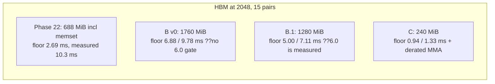
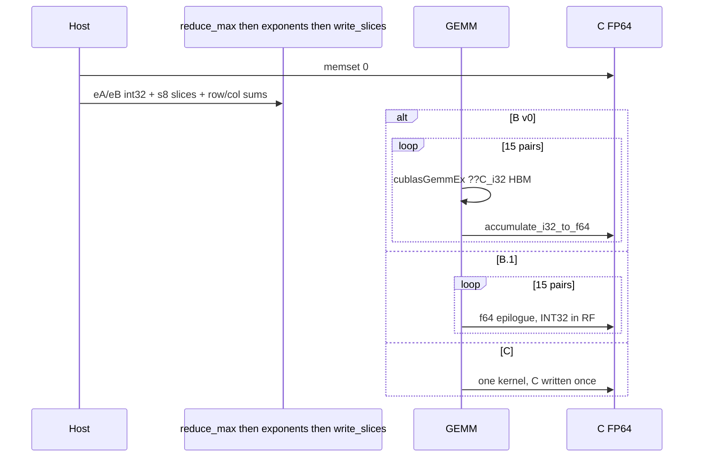
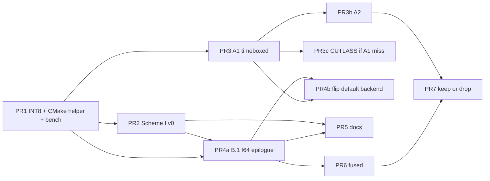

# AdaptiveGEMM Scheme I嚗da INT8 Tensor Core ? ~80% 撜啣€?

| 甈? | ??|
|------|----|
| **?辣** | SPEC_int8_peak |
| **雿€?* | AdaptiveGEMM / iThome 蝟餃? |
| **?交?** | 2026-08-21 |
| **?€??* | Draft嚗ev 5嚗?|
| **蝭?蝖祇?** | RTX 4060 Laptop, SM 8.9 only嚗 TMA / ??wgmma / ??TMEM嚗?|
| **撠?蝔?** | `case_2/adaptive_publish_tmp` |
| **?賊?蝑?** | `docs2/int8_gemm.md`, `docs2/io_vs_cublas.md`, `docs2/HANDOVER.md` |

---

## Overview

Phase 22嚗?-slice Ozaki + 7-prime CRT嚗 2048糧 `U(-1,1)` 銝歇韐? native `cublasDgemm`嚗82 ms / 209 GFLOPS嚗?雿?銝?cuBLAS 13 Ozaki emu **34-bit FIXED**嚗?*3.97 ms / 7.62e-10**嚗??Ｙ? **2.8?**嚗炊撌桐?撌桐????嚗???3.40e-9嚗€?豢???€??賢?瘛瑕??憿?`crt_fast_kernel` 鋆∩耨嚗?

1. **Kernel ?釭嚗?* ?瘜?CRT ???? 28 甈?INT8 GEMM嚗RT **8.86??.38 ms / 28 ??0.32 ms ??~51??4 TOPS嚗43% of 121嚗?*?€ Barrett + XOR 銋??摮?13.6 ms ?誨??~40 TOPS / 30% ?芰甇瑕?箇??uBLAS ?桅? INT8 ??~100 TOPS ?臬? DYNAMIC emu 8.5 ms / ~49 GEMM **?**嚗?*銝**?砍 `cublasGemmEx(CUDA_R_8I)` 撖行葫嚗ate A1/A2 撠? cuBLAS INT8 閬誑 PR1 ??`bench_int8_gemm_vs_cublas` ?箸???
2. **瞍?瘜?IO嚗?* ?€? Scheme I ??2 ??hi/lo ?? Scheme II ??7 鞈芣嚗???**28 甈?* HBM K-sweep嚗uBLAS ?舐? Scheme I嚗?4-bit ??`sliceCount = ceil((34+1)/8) = 5` 撘?8-bit slice?emo ??34-bit ?唳? 25 GEMM嚗slices*slices`嚗???spec ?€漲?身頝?**15 ??甈? pair**嚗a+b ??4`嚗€€???3.97 ms? **?? mantissa bit count**嚗??臬?銝€ GEMM 甈⊥?€cublas.dll` ?折??15 ? 25 ?€?銝??

?祆?隞嗆???皛?INT8 Tensor Core????4-bit 蝡臬蝡舫?餈?3.97 ms??????函??蔥??畾蛛?**銝?霅洵銝€憭拙停韐?cuBLAS**????皞????

| # | ?格? | ?€瑼?|
|---|------|------|
| 1 | ?桃 s8?s8?32 GEMM嚗?048糧嚗?| Gate A1嚗70% ? 121 **??* ??0% ? **撖行葫** `cublasGemmEx` INT8?ate A2嚗80% ? 121 **??* ??5% ? 閰脣祕皜研€?*A2 ?舀?憿?璅?銝 Scheme I ?箄疏璇辣??* |
| 2 | 蝡臬蝡?34-bit Scheme I | **?芣? B.1**嚗n-tree GEMM + RF ??INT32?64 epilogue嚗???6.0 ms ??3.97 ? 1.5嚗€ v0嚗uBLAS INT8 + INT32 scratch嚗?*瘝?**???€tretch 4.76 ms ?舐?撘???銝 Stage C ??摰儔??|
| 3 | 隤文榆 | vs native DGEMM max error ??**1e-8**嚗???~**1e-9**??5 pair ??25 pair ?質??晞€?|

**隤祕蝯??神?典??ｇ?**

- fused p=5 閬???啜€憿?INT8 GEMM ??80% 撜啣€潦€嗾銋??航?€da 瘝? TMEM嚗簡 蝯?INT32 acc ?曆???RF?tage C ???? **HBM O(p)** ??**?臬敹恍????B.1**嚗???tensor pipe 80%嚗?銝? 4.76 ms??
- naive 15-pair ??INT32 撖怠? HBM ??嚗?664 MiB嚗?56 GB/s 銝? **6.50 ms**嚗?*?拍?銝?銝? 6.0 ms**??.0 ms ??拍 B.1?ate A1 **銝** v1 ????隞塚?瘝? f64 epilogue嚗?0% MMA 銋?銝???1200 MiB reduce??
- ?身頝臬?蝬剜? `ExecutionMode::Phase22`嚗??Scheme I ?函移摨虫???嚗€漲?蝞???

---

## Background & Motivation

### ?暹?嚗???箸?嚗?閬???Phase 24 ??130 ms 雓?鈭?

??蝯??€?銝€??`examples/demo_main.cpp`嚗?048糧?U(-1,1)`?TX 4060 Laptop?UDA 13.0嚗?

| 頝臬? | ?? | 蝑? GFLOPS | vs native | max error vs native |
|------|-----:|------------:|----------:|--------------------:|
| cuBLAS native DGEMM | 82.2 ms | 209 | 1.0? | ??|
| Phase 22嚗OR swizzle 敺? | **10.3??1.2 ms** | ~1540??660 | ~7.5? | **3.40e-9** |
| cuBLAS emu DYNAMIC | 8.5??.8 ms | ~1940??010 | ~9.5? | 2.84e-13 |
| cuBLAS emu **FIXED 34-bit** | **3.97 ms** | ~4330 | ~21? | **7.62e-10** |

蝚砌?甈?`execute()` ?董嚗AdaptiveOzakiEngine::execute` 敹怨楝敺?`printed_break`嚗?`pack ~1.66 ms  crt ~8.9??.4 ms`?precision_test` 512嚗ax error 1.52e-9嚗? 1e-8??

撌脣?銝???敺株矽嚗?

| ?孵? | 蝯? |
|------|------|
| ?踵? Phase 24 naive residual | 130 ms ??銝?韏圈€?嚗?閮?Phase 22 |
| magic rem + Barrett CRT | 13.6 ??10.9 ms嚗炊撌桀?銝€憿?蝝?|
| XOR smem swizzle?ad 48??4 | 10.9 ??10.3 ms嚗ank conflict **瘝?銝€甈⊥???* |
| ??銝??釭??k=0 | CRT 霈嚗?*撌?revert** |

蝑? INT8 TOPS嚗2 n糧 / (t_crt / 28)`嚗 Barrett/ALU嚗 MMA issue ??*銝?**嚗?

| ?誨 | CRT ms | ms / 28 | 蝑? TOPS | vs 121 |
|------|-------:|--------:|----------:|-------:|
| Barrett ??13.6 ms wall嚗?| ~12.2 | **0.44** | **~40** | ~33% |
| **?暹?嚗agic+Barrett+XOR嚗?* | **8.86??.38** | **0.32??.33** | **~51??4** | **~43%** |

敺??瘜?kernel??敺 **~54 TOPS / 0.32 ms**??0 TOPS ?芸?曉甇瑕銵具€?

### ?曉 kernel 撖阡??典?隞€暻?

`execute()` 敹怨楝敺?`src/AdaptiveOzaki.cu`嚗!do_fp64 && !do_residual`嚗?

1. `cudaMemsetAsync(dC, 0, ?? /*default stream*/ 0)` ?€?靽桅? non-blocking memset ??銝€頛?CRT ?嗅神?€?? execute 霈? 4? ??bug??
2. `precompute_modulo_hl_A/B`嚗P64 ??7 鞈芣 ? {hi, lo} INT8嚗sh = 2^17`?sl = 2^34`嚗神??HBM tiled layout??
3. ?活 `crt_fast_kernel<<<dim3((n+63)/64, (m+127)/128), 256>>>`嚗?
   - pass 0: Ah?Bh ? 2^{-34}
   - pass 1: Ah?Bl ? 2^{-51}
   - pass 2: Al?Bh ? 2^{-51}
   - pass 3: Al?Bl ? 2^{-68}

`crt_fast_kernel` ?芣 `crt_pass_kernel_body<false, false>`嚗摰?7 鞈芣? ??`+=` ??atomic嚗€ody 鋆∴?

- tile **128?64**嚗?56 threads嚗? warp嚗?瘥?warp **32?32**
- `__shared__ int8_t sa[2][128][64], sb[2][64][64]`嚗=32嚗?*2-stage `cp.async`**
- `swizzle_k16(row, col) = col ^ ((row & 3) << 4)`
- 瘥€釭??**摰??甈?K**嚗mma.sync.aligned.m16n8k32.row.col.s32.s8.s8.s32`
- 瘥€?K-tile ??MMA 蝢斤?**銋???敺?銝€甈?* `__syncthreads`嚗AdaptiveOzaki.cu:826-854`嚗?銝瘥? `mma.sync` ????甈?
- ?嗅? `rem_prime_u32`嚗__umulhi` + `d_prime_magic`嚗? `barrett_mod_M7`嚗M = 168897325606883`嚗mu = 109218`嚗?
- `__launch_bounds__(256, 3)`

NCU嚗? `decoupled_crt_pass_kernel`嚗?*銝**?曉 e2e嚗?Tensor (INT) pipe **37.0%**?ccupancy **48.10%**?mem bank conflict 隞?嚗docs/31_Phase24_26_Performance_Tuning_and_Occupancy.md`嚗€esidual ?踵?銋?嚗?*?? MMA 撠望銝餃?**??

### ?箔?暻澆?隤?`crt_fast_kernel` 餈賭???2.8?

`docs2/io_vs_cublas.md` 撌脩?撖急香嚗?7-bit ? 17-bit ? K=2048 憛???int32嚗126*126*2048 = 32.5e6` ?芣擗??銝?嚗?甇?17-bit ?湔銋? ?K ?€閬?CRT嚗€uBLAS ??8-bit 撠望?箔???甈?MMA = 銝€甈∠移蝣?INT32 GEMM?€?? 17-bit + CRT ?舐鈭? slice嚗???甈∟??乓€BM 甈⊥?€憭€?

蝜潛?敺株矽 Barrett / swizzle / prefetch ?臬?芸?銝€璇?頛眼??Scheme II? spec ??Scheme I??

---

## Goals & Non-Goals

### Goals

- **Stage A嚗?* ?函? s8?s8?32 GEMM kernel嚗?048糧 撠? **撖行葫** `cublasGemmEx(CUDA_R_8I, CUBLAS_COMPUTE_32I)`??瘛?CRT??瘛?Ozaki packing?R1 鈭文**銝€憿撖虫???template kernel**嚗迤蝣箸€改?嚗?0% ??Gate A2 / PR3b ??蝛園?嚗???PR1 ??蝝€?
- **Stage B v0嚗?* Scheme I host + `cublasGemmEx` INT8 + INT32 scratch??甈?launch??*甇?Ⅱ?折? only**嚗rr ??1e-8嚗€uBLAS INT8 epilogue ??INT32嚗€?頝?**敹** ??INT32 撖怠? HBM嚗?*銝? 6.0 ms**??
- **Stage B.1嚗?* in-tree GEMM嚗NT32 acc ? RF嚗pilogue ?湔 `C_f64 += ?圳????**瘥?pair 銝€甈?launch**?€???6.0 ms ??頛??
- **Stage C嚗?* 銝€憿?kernel嚗窒 K 頛 slice 銝€甈∴?on-chip acc嚗 撖思?甈～€???= 敹恍????B.1 **銝?* HBM O(p)??
- Phase 22 CRT 頝臬?靽??航??皜研€?*隞 default**??
- `ExecutionMode` / Python `mode=` ??A/B??
- Demo ?啣 INT8 TOPS ??vs `cublasGemmEx` INT8嚗R1 韏瑕撥??`--int8-bench`嚗€?

### Non-Goals

- ??spec **銝恣** Hopper/Blackwell嚗gmma?MA?MEM嚗€?
- 銝恣韐?cuBLAS DYNAMIC / 1e-13??
- 銝恣??Phase 24 residual ??靘? 1e-15??
- 銝恣蝚砌???17-bit嚗ass 4??嚗€?
- 銝恣??`crt_fast_kernel` ?颯€?靘踴€? 80%??
- 銝恣?券?瘝?蝑??? swizzle ?嗅銝€ PR??
- 銝恣??CMake 敺€閮?nvcc 蝺刻陌 `.cu.obj`??甈⊿?撖急? `enable_language(CUDA)`??
- 銝恣隞餅? `m,n,k`嚗1 憟?嚗m % BM == 0`?n % BN == 0`?k % BK == 0`嚗?撠??臬?蝥?PR?<128,128,64,3>` 銝 128 / 128 / 64嚗€?

---

## Hardware Budget嚗m_89 / 4060 Laptop嚗?

NCU CSV ??`cudaGetDeviceProperties` 撠?銝?`NVIDIA GeForce RTX 4060 Laptop GPU`嚗M 8.9嚗?4 SM嚗?536 threads/SM嚗?5536 regs嚗2 24 MB嚗ax shared **101376 B**??

| ? | ??| 靘? / ?冽? |
|------|----|-------------|
| GPU | RTX 4060 Laptop, AD107 | demo `cudaGetDeviceProperties` |
| SM | 8.9嚗?*24** SM | Ada 128 CUDA cores/SM ??3072 cores |
| L2 | **24 MB** | 2048簡 INT8 A+B+C_i32 = 4+4+16 = 24 MB嚗?憟質票朣?|
| HBM | 128-bit ? 16 Gbps ??**256 GB/s** ?? | **閬???~180 GB/s**嚗aptop TGP derate嚗€??撘???256??|
| SMEM / SM | **101376 B** | fused slice ?′銝? |
| Registers / SM | 65536 | occupancy 閮???|
| Max threads / SM | 1536 | Ada |
| INT8 MMA | `mma.sync.aligned.m16n8k32.row.col.s32.s8.s8.s32` | 4096 MAC = 8192 ops / ?誘 |
| ??甇交鞎?| `cp.async.cg.shared.global` 16B | Ampere+嚗?*瘝?** TMA |
| Dense INT8 撜啣€?| **~121 TOPS** | 撱?? sparse ~242 ????**銝**?砍??撖行葫 |

?桐? 2048糧 INT8 GEMM嚗2 n糧 = 17.180e9` ops??

| ?? | ?? | ?酉 |
|------|-----:|------|
| 121 TOPS嚗?00% ??嚗?| **0.142 ms** | 銝? |
| 97 TOPS嚗?0% ??嚗?| **0.177 ms** | Gate A2 |
| 85 TOPS嚗?0% ??嚗?| **0.202 ms** | Gate A1 |
| ~54 TOPS嚗瘜?CRT 蝑?嚗?| **0.32 ms** | 8.9 ms / 28 |
| ~40 TOPS嚗arrett ?? | **0.43 ms** | 甇瑕 |
| cuBLAS INT8 | **PR1 ??** | ?券銋?蝳迫撖急???∪予?望 100 TOPS??|

Roofline嚗?隢?HBM 256 GB/s嚗?ridge ??121e12 / 256e9 = **473 ops/byte**?憿?2048糧? 撖?INT32嚗raffic 24 MB ??AI = 17.18e9 / 24e6 = **716 ops/byte > ridge**嚗?*?湧???compute-bound**??隞亦瘜?~43% 銝 HBM 銝?嚗 tiling / pipeline / 雿?€?

CTA ?亙??128?64 銝???L2 ?嚗I = `2繚128繚64 / (128+64)` = 85.3 MAC/byte = 171 ops/byte **< ridge**?? MB operand ?脣?鈭?24 MB L2嚗CU 隞＊蝷?tensor pipe 37%嚗誨銵?L2 ??鈭?issue rate??

**???陸?潘?** ???晞€s 121 TOPS???s ?偕撖詨祕皜?`cublasGemmEx` INT8?€aptop TGP 銝帘??**撠? cuBLAS INT8 ?芸??潛?隢?121**?emo ?? `prop.memoryBusWidth`?clockRate`?sharedMemPerMultiprocessor`嚗??121/256 ?香??SKU 銵具€?

---

## Proposed Design

### 蝮賣瑽?

銝€?*鈭**??Scheme I ??嚗?閬毽????嚗?

```text
B v0     execute_scheme_i_v0
         cuBLAS INT8 + INT32 scratch ?賢 + accumulate_i32_to_f64
         15 launch嚗?664 MiB嚗 6.0 ms ??

B.1      int8_gemm_s8s8s32_f64_epilogue ? 15
         in-tree only嚗NT32 ??RF嚗? launch 撖???C_f64
         6.0 ms ???ㄐ

C        scheme_i_fused
         1 launch嚗 slices 瘝?K 霈€銝€甈∴?C 撖思?甈?
         ?? = 敹恍????B.1 銝?HBM O(p)
```



```mermaid
flowchart TB
    subgraph today [Today: Phase 22 default]
      FP64in[A,B FP64] --> PackCRT["precompute_modulo_hl_A/B<br/>7 primes ? hi/lo INT8"]
      PackCRT --> K1["crt_fast_kernel ? 4 pass<br/>each: 7 sequential K-sweeps"]
      K1 --> C22[C FP64 += reconstruct]
    end

    subgraph stageA [Stage A: isolated INT8 GEMM]
      A8[A int8 row-major] --> Kint8["int8_gemm_s8s8s32<128,128,64,3>"]
      B8[B int8 row-major] --> Kint8
      Kint8 --> Ci32[C int32]
      CuB["cublasGemmEx CUDA_R_8I COMPUTE_32I"] -.->|bench only| Ci32
    end

    subgraph stageBv0 [Stage B v0: correctness]
      Split0[split_AB_int8] --> Loop0["15? cublasGemmEx ??C_i32 HBM"]
      Loop0 --> Acc0[accumulate_i32_to_f64]
    end

    subgraph stageB1 [Stage B.1: 6.0 ms vehicle]
      Split1[same slices] --> Loop1["15? int8_gemm_s8s8s32_f64_epilogue<br/>INT32 in RF"]
      Loop1 --> Csi[C FP64]
    end

    subgraph stageC [Stage C: fused]
      Split2[same slices] --> Fused["one kernel, O(p) HBM"]
      Fused --> Cfu[C FP64]
    end
```

撱箄降撖虫???嚗R1嚗迤蝣?INT8 GEMM + CMake 憭?`.cu` 璅∪? + `--int8-bench`嚗???PR2嚗 v0嚗?*rebase ??PR1 ??CMake helper 銝?*嚗??`scheme_i.cu.obj`? v0 **銝?*霅? 6.0 ms?.1 ??f64 epilogue嚗R4a嚗?蝑犖摰?70%? ??B.1 ?炊撌桅銋???

### Stage A ??摮斤? INT8 GEMM

? Triton/CUTLASS ??嚗?*銝?敺?`crt_pass_kernel_body` ?瑕靘?*?隞?template 蝬?鞈芣餈游??final_weighted_sum[2][4][4]` uint64?RT tiled layout?=64??-stage??

**80% 撜啣€潭 Gate A2 ??撠???銝 PR1 撖怠?銝???蝝€?* PR1 ?芯漱銝??憿擃?kernel??

#### PR1 憟? kernel嚗?湔撖虫?嚗?

Compile-time template嚗?*銝** runtime `Int8GemmConfig`嚗?

```cpp
// include/int8_gemm.h
namespace ozaki {

// v1 alignment contract: m % BM == 0, n % BN == 0, k % BK == 0.
// (BK, not MMA-k=32: the K loop steps by BK.)
// PR1 instantiates exactly one kernel: <128,128,64,3>.
template<int BM, int BN, int BK, int Stages>
void int8_gemm_s8s8s32_launch(const int8_t* A, const int8_t* B, int32_t* C,
                              int m, int n, int k, cudaStream_t stream);

inline void int8_gemm_s8s8s32(const int8_t* A, const int8_t* B, int32_t* C,
                              int m, int n, int k, cudaStream_t stream) {
    int8_gemm_s8s8s32_launch<128, 128, 64, 3>(A, B, C, m, n, k, stream);
}

// B.1 only (PR4a). Not used by the cuBLAS backend.
// row_sum / col_sum / bias_* match accumulate_i32_to_f64 (B v0).
// Compensation is applied ONCE after the full-K MMA, not per BK tile:
//   acc_u = acc_mma + bias_b*row_sum[i] + bias_a*col_sum[j] + bias_a*bias_b*k
//   C[i,j] += ldexp((double)acc_u, eA[i] + eB[j] + slice_shift)
void int8_gemm_s8s8s32_f64_epilogue(
    const int8_t* A, const int8_t* B, double* C,
    const int32_t* eA, const int32_t* eB,
    const int32_t* row_sum, const int32_t* col_sum,
    int bias_a, int bias_b, int m, int n, int k, int slice_shift,
    cudaStream_t stream);

struct Int8GemmBench {
    double our_ms, cublas_ms, our_tops, cublas_tops, peak_frac, vs_cublas;
};
Int8GemmBench bench_int8_gemm_vs_cublas(int m, int n, int k);
} // namespace ozaki
```

瘝? runtime `{bm,bn,bk,stages}` struct嚗???`__shared__ int8_t sa[Stages][BM][BK]` 敹??舐楊霅舀?撣豢?R3 ?亥???tile嚗?*??template 撖虫?**嚗?憒?`<128,256,64,3>`嚗?銝€??compile-time 銵剁???host ??`if (n % 256 == 0)` ??launch嚗??舀? tile ??kernel ???

瘝? `int8_gemm_s8s8s32_accum`嚗eta=1 撖?INT32 C嚗€€?舫隤斤? B.1 epilogue??

cuBLAS 撠嚗? demo ??憟?row-major ?€撌改?`C=A*B` ??column-major `C=B*A`嚗?

```cpp
int32_t alpha = 1, beta = 0;
cublasGemmEx(h, CUBLAS_OP_N, CUBLAS_OP_N, n, n, n,
             &alpha, d_B, CUDA_R_8I, n, d_A, CUDA_R_8I, n,
             &beta, d_C, CUDA_R_32I, n,
             CUBLAS_COMPUTE_32I, CUBLAS_GEMM_DEFAULT_TENSOR_OP);
```

#### Warp / smem / 蝞∠?嚗<128,128,64,3>`嚗?56 threads = 8 warps嚗?

| ??| ??|
|----|----|
| CTA | BM=128, BN=128, BK=64 |
| Threads | 256嚗? warps嚗?|
| Warp map | `wm = wid / 2`嚗?..3嚗€wn = wid % 2`嚗?..1嚗? warp tile **32?64**?ms = wm*32`嚗ns = wn*64` |
| C acc / thread | 32?64 / 32 = **64 INT32** |
| MMA / warp / K=32 | 2?8 甈?`m16n8k32`嚗 ?孵??拙€?16? ?孵??怠€?8嚗?|
| Stages | 3 |

**Gmem layout嚗?* A? ?賣 **row-major** `A[m,k]`?B[k,n]`嚗? `cublasGemmEx` ?梁??

**Smem嚗?*

- A嚗int8_t smem_A[Stages][BM][k_stride]`嚗k_stride = 128`嚗K=64 鞈? + 64 B pad嚗€mem A ??K ???嚗cp.async` 16 B 瘝?K??
- B嚗int8_t smem_B[Stages][BN][k_stride]`嚗k_stride = 64`?mem B ??N ???嚗cp.async` 16 B 瘝?N??*`ldmatrix.sync.aligned.m8n8.x2`** ??`[k,n]` 頧? `mma.row.col` 閬? K-major B fragment?€撠?`get_B8_offset` ??車撌?K-contiguous ??CRT layout ??蝣箸?€€ kernel **銝?** gmem 頧蔭??

Pad ??128 B ?舐鈭??ａ€? XOR嚗?4 B 銵祝??`(row&7)<<4` ?? col xor ????4嚗€?

**XOR swizzle嚗 ??K 蝬准€ ??N 蝬剖?銝€?賣嚗omain 銝?嚗?**

```cpp
// col_b: 16-byte aligned offset in the *logical* row.
// A: col_b ??[0, BK)  into stride 128  (BK=64 data, 64 B pad)
// B: col_b ??[0, BN)  into stride 128  (BN=128, no pad ??includes 64..127)
// 16-byte XOR, 8-row period. Used by both cp.async store and ldmatrix addr.
__device__ int swizzle_16B_8row(int row, int col_b) {
    return col_b ^ ((row & 7) << 4);
}
```

???賣??銵冽 8 ??16 B chunk 鋆∠? **????* `{0,16,32,48}`? ???€ `64+{0,16,32,48}`嚗or ?脣?銝€ 128 B 銵?靘? row 4?ol_b=64 ??0嚗?*銝１??*嚗???A ?€?? M? ?€?? K-row嚗揣撘征???€祕雿??domain ?嗆? `[0,64)`嚗 ??64..127 ?雁???把€€€迤?舫€?閬???bank-conflict??

16-row ?詨€潔?嚗col_b = 0, 16, 32, 48`嚗 ?血? `64, 80, 96, 112` 韏啣?銝€ xor嚗?

| row | xor | 0 | 16 | 32 | 48 | 64 | 80 | 96 | 112 |
|----:|----:|--:|---:|---:|---:|---:|---:|---:|----:|
| 0 / 8 | 0 | 0 | 16 | 32 | 48 | 64 | 80 | 96 | 112 |
| 1 / 9 | 16 | 16 | 0 | 48 | 32 | 80 | 64 | 112 | 96 |
| 2 / 10 | 32 | 32 | 48 | 0 | 16 | 96 | 112 | 64 | 80 |
| 3 / 11 | 48 | 48 | 32 | 16 | 0 | 112 | 96 | 80 | 64 |
| 4 / 12 | 64 | 64 | 80 | 96 | 112 | 0 | 16 | 32 | 48 |
| 5 / 13 | 80 | 80 | 64 | 112 | 96 | 16 | 0 | 48 | 32 |
| 6 / 14 | 96 | 96 | 112 | 64 | 80 | 32 | 48 | 0 | 16 |
| 7 / 15 | 112 | 112 | 96 | 80 | 64 | 48 | 32 | 16 | 0 |

`ldmatrix` 雿?敹?韏?*????* `swizzle_16B_8row`?€??砍???PR1 ??蝝?PR3 ?交????mask嚗?撣嗡?撘萄?璅? 64..127 ?”??

SMEM ?券?嚗 3?128?128 = 48 KB嚗 3?64?128 = 24 KB嚗?閮?**72 KB** ??1 CTA/SM嚗?01376 B 銝?嚗€ccupancy 256/1536 ??17%?? 64 ??INT32 acc ??ILP嚗???3 CTA??

**`cp.async` wait嚗?* ?暹? `cp_async_wait_0/1`嚗AdaptiveOzaki.cu:16-21`嚗?憭?3-stage?elper ?芣 PTX嚗?*銝** `get_A8_offset` / `get_B8_offset` / `swizzle_k16` / `fp64_hi`嚗??CRT layout嚗27??5嚗?

```cpp
// include/mma_sm89.cuh  ??敺?AdaptiveOzaki.cu ?芣 9??1 ??57??1
template<int N>
__device__ __forceinline__ void cp_async_wait() {
    asm volatile("cp.async.wait_group %0;\n" :: "n"(N));
}
```

3-stage 銝餉艘? `cp_async_wait<Stages-2>()` ??`wait_group 1`??

**RF fragment ?楨銵?80% ??閬?隞塚?PR1 撠梯?撖思?嚗雿輸?瘝?80%嚗?** 敹?閬? warp ??**2?8** 甈?`m16n8k32`嚗??臭?憿?16?8嚗?

```cpp
uint32_t a_frag[2][2][4]; // pipe ? M-mma (2?16) ? ldmatrix.x4
uint32_t b_frag[2][8][2]; // pipe ? N-mma (8?8) ? ldmatrix.x2
```

A ??`ldmatrix.sync.aligned.m8n8.x4`嚗 .trans嚗?B ??`ldmatrix.sync.aligned.m8n8.x2`?ane?mem 韏啗? store ?詨???`swizzle_16B_8row`嚗TX m8n8.x4 ??8?8 摮?撠?嚗€?甇?`a_frag[2][4]`嚗?芣? 1 ??M-mma嚗???16?8 銝 32?64嚗€?

**CTA raster嚗R1 ????嚗?* `grid = dim3(n/BN, m/BM)`嚗blockIdx.x` = N tile?blockIdx.y` = M tile?R3 ?? L2 swizzle嚗int n_tile = blockIdx.x ^ (blockIdx.y & 7)`嚗n/BN` ??8 ?€??2048/128=16嚗K嚗€€撣貉◤?蹂?餈賣?敺?10??0% vs cuBLAS ?銝€??銝 PR1 甇?Ⅱ?抒??€?

**Inner loop嚗?*

```text
prologue: cp.async stages-1 K-tiles, commit
          wait, syncthreads
          ldmatrix.x4  A ??a_frag[0][0..1]
          ldmatrix.x2 B ??b_frag[0][0..7]
          p = 0
for k0 in 0..K step BK:
    prefetch k0+(stages-1)*BK into smem[write]
    cp_async_wait<Stages-2>()
    __syncthreads()
    for k1 in 0..BK step 32:
        # Next MMA-k into frag[p^1]. BK=64 ??k1?0,32}.
        # k1=32 is k=64 = first MMA-k of the NEXT BK tile ??not in smem[read].
        # Skip is every BK tile, not only last k0.
        if k1 + 32 < BK:
            src = smem[read];   k_off = k1+32     # same BK tile
        elif k0 + BK < K:
            src = smem[read+1]; k_off = 0         # next BK, already wait_group 1
        else:
            src = null                            # last k1 of last k0
        if src:
            ldmatrix.x4        src A, k_off ??a_frag[p^1][0..1]
            ldmatrix.x2  src B, k_off ??b_frag[p^1][0..7]
        for i in 0..1:
          for j in 0..7:
            mma.sync.m16n8k32 a_frag[p][i], b_frag[p][j], acc[i][j]
        p ^= 1
    rotate smem stages
    __syncthreads()                         # once per BK tile, not per mma
epilogue: st.global.v4 INT32 C, 128?128
```

**Split-K嚗?* `K_max ??2^31/(127*127) ??1.33e5`??048 ???潦€1 銝? split-K嚗m % BM`?n % BN`?k % BK` 隞颱?銝?蝡?**?湔 `cudaErrorInvalidValue`**嚗?朣?蝝?銝?silent pad嚗€<128,128,64,3>` 銝?n=32 敹?韏圈€? error嚗???CPU gold??

#### ?箔?暻潛瘜?128?64 / 2-stage ??皛?

- 8 warp ? 2?4 `mma.m16n8k32` = 64 MMA / K-step嚗=64 霈?CTA AI 雿 ridge
- **瘥€?K-tile MMA 蝢斤?**?? `__syncthreads`嚗??舀?璇?MMA嚗??? bank conflict??-stage ?芣???32 ??K
- 鞈芣銋??? K嚗ipeline 鋡?CRT ?嚗tage A 瘝??挾嚗?
- inner loop 瘝? RF ?楨銵?

#### Tile ??嚗R3 / PR3b嚗???PR1嚗?

| CTA tile | stages | SMEM A+B嚗 128 B stride嚗?| CTA/SM | ?酉 |
|----------|--------|------------------------------|--------|------|
| 128?64?32 CRT | 2 | 24 KB | 3 | 銝???Stage A 韏琿? |
| **128?128?64** | **3** | **72 KB** | **1** | **PR1 ?臭?撖虫?** |
| 128?256?64 | 3 | ~96 KB | 1 | PR3 ?嚗arp ??2?4 ??64?64嚗?28 i32/thread |
| 128?128?128 | 3 | smem 皛?| 1 | PR3b |

#### 甇?Ⅱ?折?

`tests/int8_gemm_test.cpp`嚗Make ????`adaptive_gemm_precision_test` 銝€璅?? **?函? executable**嚗?

- CPU gold嚗?*n = 128 ??512**嚗??256嚗??冽? s8嚗int32` 銝?餈游???*蝳迫** 2048糧 CPU ??嚗8e9 MAC嚗€?*蝳迫 n=32 ??gold**?€? `<128,128,64,3>` 摰?????`m%128`?n%128`?k%64`??
- **鞎葫嚗?* 32糧嚗誑?遙銝€ `k % BK != 0`嚗??? `cudaErrorInvalidValue`嚗???pad 敺?蝞€?
- vs `cublasGemmEx` INT8嚗?*bit-exact**?=128/512 ?暸€€葫閰佗?n=2048 ??`int8_gemm_perf`嚗elf-hosted嚗€?
- ??朣?`m,n,k`嚗1 **out of contract**嚗?皜祇憭???
- ?漲憭望?銝? `precision_test` 蝝€?

瘥€ launch 銋? `CHECK_CUDA(cudaGetLastError())` + 皜祈岫??`cudaDeviceSynchronize`??

### Stage B ??Scheme I host

??撠 ozIMMU嚗split_AB_int8` ??loop INT8 GEMM ??`accumulate_in_f64`?uBLAS ?Ｗ??敦蝭€銝?€?4-bit?=5??

#### ?詨飛??pair ??

`p = ceil((mantissaBitCount + 1) / 8)`嚗?4-bit ??**p = 5**??

銝???**銝?雿???pair**嚗??舐???閫€A_a B_b ??A_b B_a`??

0-based `a,b ??{0,1,2,3,4}`嚗?

| 璇辣 | pair ??|
|------|--------:|
| `a+b ??3` | 10 |
| **`a+b ??4`** | **15 = p(p+1)/2** |
| `a+b ??5` | 19 |
| ?∴?p簡嚗?| 25 |

**?身 `scheme_i_pair_threshold = 4`??* ?阮撖?T=5 ??15 pair ?舐??荔??? 19嚗€ost ?典?銝€??enumerator嚗?

```cpp
inline int scheme_i_for_each_pair(int p, bool triangular, int T,
                                  const std::function<void(int a, int b)>& fn) {
    int n = 0;
    for (int a = 0; a < p; ++a)
      for (int b = 0; b < p; ++b)
        if (!triangular || a + b <= T) { fn(a, b); ++n; }
    return n;
}
```

?格葫嚗p=5, triangular=true, T=4` ??15嚗T=5` ??19嚗triangular=false` ??25?emo ??`pairs_launched`??

皛?25 pair ??*蝎曉漲 oracle**嚗??園€漲?身??

**銝?**??Phase 22???Ah?Bh 銝€ pass ??1e-9? Scheme I ?臭? pair ???€??17-bit Ozaki ??鋆∠? hi?hi嚗???憭扳 8-bit stack ??`(a,b)=(4,4)`?R2 敹??典?銝€ 2048糧 `U(-1,1)` **隞亙?** 銝€蝯?mixed-magnitude嚗?/甈?`max |A|` 撌桀 ~2^8嚗???15 vs 25 ??max error嚗?*銋?**??蝯?T??????T=4 ?芣?漲?身嚗I ?拍車?質???

?撟唾魚 vs 3.97 ms?? ??`MaxMantissaBitCount=34`?emo ??34-bit ?唳? 25 GEMM嚗uBLAS 撖阡? launch ?豢?乓€?5 pair 撠??擛€?隤文榆?渡???

INT32 銝滯雿?`127*127*2048 = 33,014,048 < 2^31-1`?ero-pointed 銝?`|s8|??27` 隞?蝡?鋆???`128*row_sum` 韏?INT64 ???f64??

#### Digit encoding嚗8 MMA ?舫?撱綽??€??€?暺?靘?

`mma.sync.s32.s8.s8.s32` ??`CUDA_R_8I` **?芸??? s8**?瘥??賜 s8 閫?? 2's complement ??raw byte嚗q = -1`嚗?6-bit嚗??拍? `[-1,-1]` 銋靘 66049 銝 1??

**?詨?蝺函Ⅳ嚗SB嚗lice 0嚗???s8嚗擗? unsigned digit zero-point ??s8??*

?湔 `q = round(ldexp(A, -eA) * 2^{mantissa_bits})`嚗??8p-bit 2's complement 摰孵嚗=5 ??40 bit嚗?

```text
q = 峉_{s=0..p-1} u_s * 2^{8*(p-1-s)}
u_0 ??[-128,127]          # MSB, ?湔摮? int8
u_s ??[0,255]  (s??)      # 雿?嚗? S_s = (int8_t)(u_s - 128)
```

蝞??喟宏??MSB嚗u_0 = (int8_t)(q >> 8*(p-1))`????`u_s = (q >> 8*(p-1-s)) & 0xFF`嚗ogical 8-bit嚗€?

GEMM ?? S嚗???u?? pair (a,b)嚗?

```text
bias_a = (a == 0) ? 0 : 128
bias_b = (b == 0) ? 0 : 128
峉_k (S_a + bias_a)(S_b + bias_b)
  = 峉 S_a S_b + bias_b 峉 S_a + bias_a 峉 S_b + bias_a * bias_b * K
```

`峉 S_a S_b` ??s8 MMA????瘥撐 slice ??蝞?`row_sum_A[a][i] = 峉_k S_a[i,k]`?col_sum_B[b][j] = 峉_k S_b[k,j]`嚗ack ????int32嚗€pilogue嚗?

```text
acc_u = acc_mma
      + bias_b * row_sum_A[a][i]
      + bias_a * col_sum_B[b][j]
      + bias_a * bias_b * k
```

??a=b=0嚗撘?MSB嚗?bias=0嚗?? 0??

**Scale嚗?* `eA[i]`?eB[j]` ??**int32 ?**嚗???double scale??

```text
eA[i] = (max_j |A[i,j]| == 0) ? 0 : ceil(log2(max_j |A[i,j]|))
x     = ldexp(A[i,j], -eA[i])          # ?斗?嚗??啁? [-1,1]
q     = round(x * 2^{mantissa_bits})
```

**蝎曄Ⅱ shift嚗SB-first嚗?antissa_bits ?箏?嚗?**

```text
slice_shift(a,b) = 8 * ((p - 1 - a) + (p - 1 - b)) - 2 * mantissa_bits
C[i,j] += ldexp((double)acc_u, eA[i] + eB[j] + slice_shift(a,b))
```

p=5?antissa=34?i?hi (0,0)嚗slice_shift = 8*(4+4) - 68 = -4`?(-1,1) 銝?e=0 ??hi?hi 鞎Ｙ `acc * 2^{-4}`?€???typo嚗?0-bit 摰孵??????2^{32}嚗??34-bit q ??蝛??撠?2^{68} 撌?2^4??

**1-element golden嚗PU int64嚗R2 敹葫嚗?**

p=2嚗antissa_bits=8嚗?6-bit 摰孵嚗?K=1嚗A=eB=0?q=-1` ??? `0xFFFF`嚗SB s8 = -1嚗???unsigned 255 ??摮?`S=127`??

`qA=qB=-1` ?€?pair嚗slice_shift(a,b)=8*((1-a)+(1-b))-16`嚗?

| pair (a,b) | u_a, u_b | S_a, S_b | acc_u嚗MA+bias嚗?| slice_shift | ldexp(acc_u, shift) |
|------------|----------|----------|-------------------|------------:|---------------------|
| (0,0) hh | -1, -1 | -1, -1 | 1 | 0 | 1 |
| (0,1) hl | -1, 255 | -1, 127 | -255 | -8 | -255/256 |
| (1,0) lh | 255, -1 | 127, -1 | -255 | -8 | -255/256 |
| (1,1) ll | 255, 255 | 127, 127 | 65025 | -16 | 65025/65536 |

??銋? = `1 - 255/256 - 255/256 + 65025/65536` = **2^{-16}** = `qA*qB * 2^{-16}`?(1,1)` ??bias 鋆?嚗127*127 + 128*127 + 128*127 + 128*128*1 = 65025`??

?葫 `qA=qB=+1` ??`qA=-1,qB=+1`?=5?=1?q=簣1` ?典?銝€ `slice_shift` ?砍?撠?CPU `int64 qA*qB` ??`ldexp(..., -2*mantissa_bits)`?i?hi ?桅??臭誑??O(1)嚗???2^{64}?2^{-68}=2^{-4} ??p=5嚗???/鈭?鈭?銋?? `qA*qB * 2^{-2*mantissa}`?€葫閰西?瘥?*?蜇**嚗?閬 pair 撠?`qA*qB`??

#### Pack kernels嚗?憿?reduce max-abs ??exponents ??write slices嚗?

Header **?芣 `include/scheme_i.h`**?AdaptiveOzakiEngine::execute` include 摰? dispatch??閬 `AdaptiveOzaki.h` ??fork 銝€隞?private 摰????

**蝳迫撠?exponent ??`atomicMax`??* 蝛?K-tile ?亙神 `e=0`嚗 0 ?靘?嚗€銝€ tile 撖?`ceil(log2(0.4))=-1`嚗log2(0.4)??1.322`嚗?`atomicMax` 敺 0 銝 -1?max(ceil(log2 a), ceil(log2 b)) == ceil(log2(max(a,b)))` ?芸蝛?tile **銝?*隞?0 ????蝡€(-1,1) ??雿?e??嚗?mixed-magnitude ?? `(0,1)` ???漲?曉之?e=-2` ?? 0.4 蝮格? 1.6嚗???`[-1,1]`??

憟?嚗educe **raw** `max |x|`嚗double`嚗???**0.0**嚗征 tile 鞎Ｙ 0.0 = ?? max ?雿?嚗?**global max 摮銋???銝€甈?* `ceil(log2)`??

```cpp
// Pass 1: max |x| only. Init maxA[m], maxB[n] to 0.0. Never write slices or e*.
// A: grid (row_tiles,) ??each CTA owns rows, scans full K, stores maxA[i]. No atomic.
// B: grid (col_tiles, k_tiles) ??per-column max-abs on this K-slice, then
//    IEEE-754 bit atomicMax into maxB[j] (non-negative doubles: max bits == max value).
__global__ void scheme_i_reduce_maxA(const double* A, double* maxA, int m, int k);
__global__ void scheme_i_reduce_maxB(const double* B, double* maxB, int k, int n);

// After max* are complete. e = (x==0) ? 0 : (int)ceil(log2(x)).
__global__ void scheme_i_exponents_from_max(const double* maxAbs, int32_t* e, int n);

// Pass 2: eA/eB complete. Write p planes + row_sum / col_sum.
__global__ void scheme_i_write_slices_A(const double* A, const int32_t* eA,
    int8_t* slices, int32_t* row_sum, int m, int k, int p, int mantissa_bits);
__global__ void scheme_i_write_slices_B(const double* B, const int32_t* eB,
    int8_t* slices, int32_t* col_sum, int k, int n, int p, int mantissa_bits);
```

Host嚗cudaMemset(maxA/maxB, 0)` ??`reduce_maxA` / `reduce_maxB` ??`exponents_from_max` ??`write_slices_A/B`?lice ??max **銝? launch**? ??gmem ??strided in K嚗B[k*n+j]`嚗€?

?交?鈭箏???combine exponents嚗??澆?? `INT_MIN`嚗€鞈???嚗征 tile 銝神嚗?敺?`INT_MIN ??e=0`??*?身頝臬?銝粥??**?€aw max-abs 瘥???神?胯€?

Pack ?格葫嚗R2嚗?銝€甈?`max=0.4` 銝??Ｖ??瑚葡 0 ??`eB=-1`嚗ceil(log2(0.4))`嚗?銝 0嚗?銝 `floor` ??-2?皜?`max=0.5 ??eB=-1`?max=1.0 ??eB=0`嚗??ceil/floor 瘛瑟?? 0 甈???`eB=0`?葬?暹炎?伐?`ldexp(0.4, -(-1))=0.8 ??[-1,1]`??

`eA`/`eB` 隞隞?int32 摮嚗maxA`/`maxB` ??reduce scratch嚗ouble嚗?048糧 蝝?32 KB嚗€?

#### Workspace

`allocateWorkspace` ??璇辣嚗(m, n, k, mode)` 隞颱?霈停 `freeWorkspace` + ????

Scheme I **蝳迫**?蔭 `dA8_h/l`?dB8_h/l`?dmA_*`?dmB_*`?plit f32/f64?ebug嚗洵銝€甈?allocate ??workspace bytes嚗葫閰血??`cudaMemGetInfo` ??撌殷???engine 銝? `workspaceBytes()` getter??

`vram_limit_mb` ?暹???`allocateWorkspace` **瘝? enforce**?cheme I 蝬剜? advisory嚗 slices+scratch > `vram_limit_mb` ??`std::cerr` + `cudaErrorMemoryAllocation` 憭望?嚗?*蝚砌?甈?*?迤霈€?€?雿€?

2048糧?=5嚗?

| buffer | 憭批? | B v0 | B.1 / C |
|--------|------|------|---------|
| A_slices | 20 MiB | ??| ??|
| B_slices | 20 MiB | ??| ??|
| maxA, maxB | ~32 KB double | ??| ??|
| eA, eB | ~16 KB | ??| ??|
| row_sum, col_sum | ~80 KB | ??| ??|
| C_i32 scratch | 16 MiB | ??| **銝?** |
| **??** | | **~56 MiB** | **~40 MiB** |

撠? Phase 22嚗??2?(4+4)= **112 MiB** 擗??

#### 銝? host 頝臬?

```cpp
// B v0 ??PR2. No 6.0 ms claim. INT32 lands.
void execute_scheme_i_v0(...);

// B.1 ??PR4a. In-tree kernel only. INT32 never stored.
// execute() calls this when mode==SchemeI && !use_cublas && !fused.
void execute_scheme_i_b1(...);

// C ??PR6. scheme_i_fused==true.
void execute_scheme_i_fused(...);
```

B v0 餈游?嚗?

```cpp
cudaMemsetAsync(dC, 0, (size_t)m * n * sizeof(double), stream);
cudaMemset(maxA/maxB, 0);  // identity for max |x|
scheme_i_reduce_maxA<<<...>>>(...);
scheme_i_reduce_maxB<<<...>>>(...);
scheme_i_exponents_from_max<<<...>>>(maxA, eA, m);
scheme_i_exponents_from_max<<<...>>>(maxB, eB, n);
// eA/eB must be complete before any slice is written
scheme_i_write_slices_A<<<...>>>(...);
scheme_i_write_slices_B<<<...>>>(...);
CHECK_CUDA after each launch;
int launched = scheme_i_for_each_pair(p, triangular, T, [&](int a, int b) {
    cublasGemmEx(/* A_slices[a], B_slices[b] ??dC_i32, beta=0 */);
    int sh = 8 * ((p - 1 - a) + (p - 1 - b)) - 2 * mantissa_bits;
    accumulate_i32_to_f64<<<...>>>(dC, dC_i32, eA, eB,
                                   row_sum+a*m, col_sum+b*n,
                                   a==0?0:128, b==0?0:128, m, n, k, sh);
});
```

`scheme_i_use_cublas_int8=true` **瘞賊?**韏?v0?ey Decision 9 ?€NT32 銝?啜€?*cuBLAS backend ????*嚗NT8 epilogue ??INT32嚗€?閬 v0 頝臬??? B.1??

B.1 餈游?嚗?銝€ enumerator? `dC_i32`??? **full-K MMA 銋?銝€甈?*嚗.1 = 銝€ pair = 摰 K嚗????B v0 ??`accumulate_i32_to_f64` 撠?嚗?

```cpp
int launched = scheme_i_for_each_pair(p, triangular, T, [&](int a, int b) {
    int sh = 8 * ((p - 1 - a) + (p - 1 - b)) - 2 * mantissa_bits;
    int8_gemm_s8s8s32_f64_epilogue(
        A_slices[a], B_slices[b], dC, eA, eB,
        row_sum + a * m, col_sum + b * n,
        a == 0 ? 0 : 128, b == 0 ? 0 : 128,
        m, n, k, sh, stream);
});
```

`scheme_i_use_cublas_int8` ?身 **true**嚗??Gate A1 **銝?* PR4a 隤文榆蝬???PR4b ??false?2 銝?€?flip ??隞嗚€?

### 蝡臬蝡舫?蝞?銝?鈭嚗?

蝚西?嚗raffic ?冽?隞嗆靘?MiB嚗floor_256 = MiB/256` ms嚗plan_180 = MiB/180` ms?? 
`wall ??max(HBM_floor, MMA_ms) + pack_ALU_unhidden + launch`?? 
Pack ??HBM 撌脰???traffic嚗pack_ALU` ?芾? pack 瘥?HBM 憭靘?蝞?嚗???+0.3 ms嚗€aunch WDDM ~20 繕s ? N??

Pack ?臬?? FP64嚗educe max-abs + write slices嚗?`2?64 + 40 = 168 MiB`嚗??臬??104????reduce 蝞€?L2 ?賭葉嚗+B 32 MiB vs L2 24 MB嚗?閫€嚗€emset C ?西? 32 MiB write嚗 v0/B.1 ??C 鋡怒€ 撖思?甈～€?隞????

#### B v0嚗?5 pair嚗NT32 scratch嚗€???6.0 ms ??

| 甇仿? | MiB |
|------|----:|
| pack + memset C | 168+32=200 |
| 15 ? (A8+B8 霈€ + C_i32 撖? | 15?24=360 |
| 15 ? (C_i32 霈€ + C_f64 RMW) | 15?80=1200 |
| **蝮?* | **1760** |

| BW | HBM floor | MMA @54 TOPS | MMA @70% | MMA @80% | wall ??max(HBM,MMA)+0.3 |
|----|----------:|-------------:|---------:|---------:|-------------------------:|
| 256 GB/s | **6.88 ms** | 4.80 | 3.03 | 2.66 | **??7.2 ms** 隞颱? MMA |
| 180 GB/s | **9.78 ms** | ?? | ?? | ?? | **??10.1 ms** |

**B v0 ??鈭?6.0 ms??* Gate A1 ?€??⊿???

#### B.1嚗?5 launch嚗NT32 ??RF嚗? launch RMW C_f64嚗?

| 甇仿? | MiB |
|------|----:|
| pack + memset C | 200 |
| 15 ? (A8+B8) | 120 |
| 15 ? C_f64 RMW | 15?64=960 |
| **蝮?* | **1280** |

| BW | HBM floor | MMA @54 TOPS | MMA @70% | MMA @80% | wall 閬? |
|----|----------:|-------------:|---------:|---------:|----------:|
| 256 GB/s | **5.00 ms** | 4.80 | 3.03 | 2.66 | max(5.00, MMA)+0.3 ??**5.3 ms** |
| 180 GB/s | **7.11 ms** | 4.80 | 3.03 | 2.66 | **??7.4 ms** |

蝯?嚗?

- 6.0 ms ??**?芣? B.1**??
- ?? 256 GB/s 銝?HBM 撌脫 ~5.0 ms嚗MA 70% 鋡?HBM ??嚗?*Gate A1 銝 v1 ??璇辣**??80 GB/s 閬??潔? B.1 銝? 7.4 ms **頞? 6.0**嚗?暻澆祕皜祆??撖祆? 180 憟踝?閬獐皜? C RMW嚗撠?pair / ?? C嚗€?
- ?迨 6.0 ms ??**?葫??*??銝隤芰??芣?嚗 v0 銝?踝?B.1 ??256 GB/s ????180 GB/s 瘝????L2??

#### C嚗? launch嚗?

| 甇仿? | MiB |
|------|----:|
| pack嚗??FP64嚗?| 168 |
| 5?(A8+B8) 瘝?K 銝€甈?| 40 |
| C FP64 撖思?甈?| 32 |
| **蝮?* | **240** |

HBM floor嚗?56 ??**0.94 ms**嚗?80 ??**1.33 ms**?ompute 閬?Stage C 蝭€嚗?*銝 80% ? 0.177**??



### Feature flag

```cpp
enum class ExecutionMode {
    Phase22,              // default
    Phase23Hetero,
    Phase24ExtremeMix,
    Phase25Stacking,
    Phase26HybridOzaki,
    SchemeI,
};

struct OzakiConfig {
    // existing fields unchanged
    int  scheme_i_mantissa_bits = 34;
    bool scheme_i_triangular = true;
    int  scheme_i_pair_threshold = 4;      // a+b <= 4 ??15 pairs, 0-based
    bool scheme_i_use_cublas_int8 = true;  // B v0; flip only after A1 + PR4a green
    bool scheme_i_fused = false;
};
```

Python嚗AdaptiveGEMM(mode="scheme_i")`?tests/python/` ??mode 摮葡皜祈岫嚗??mode 隞?throw嚗scheme_i` 銝?throw嚗€?

### Stage C ??fused Scheme I

EmuGEMM嚗aive O(p簡) HBM ??fused O(p)?da ??TMEM嚗cc ??RF??

#### Register

?暹?瘥?thread **32** ??C ??嚗?28?64 / 256嚗€cf[2][4][4]` = 32 i32嚗final_weighted_sum` = 32 u64??

Fused ?亦瘥€?pair ??INT32嚗?5?32 = 480 reg嚗??航??

**瘙箇?隞嚗? thread 銝€蝯?FP64 acc嚗?2 ??C ?? ??64 reg嚗€?* 銝??K ?孵?靽? 15 撘?INT32 tile?nner loop ?芣? **`峉 S_a S_b`** 頧? f64嚗ilinear bias ?函???**full-K** `row_sum` / `col_sum` / `K`嚗?? K 蝯?敺?**瘥€?pair ??銝€甈?*??甇Ｗ 64 ??K-tile ?折?銴? bias嚗? 64? 憭?嚗?銋?甇Ｗ??其???? signed-s8 ??`q=-1` bug嚗€?

PR6 憟?嚗? B.1 ??蝯?pack ??`row_sum`/`col_sum`嚗orkspace 銵典歇??嚗?

```text
acc_f64 = 0                    # ONCE, 32 C elems ??pairs SHARE this acc
i32_frag reused across pairs   # not 15 tiles
for k_tiles:
    load p A/B slices for this BK
    for each pair (a,b):
        mma S_a S_b into i32_frag              # this tile only
        acc_f64 += ldexp((double)i32, shift_ab)  # 峉 S S; shift differs per pair
# once after full K (still the same 32-element acc):
for each pair (a,b):
    acc_f64 += ldexp(bias_b*row_sum + bias_a*col_sum + bias_a*bias_b*K, shift_ab)
store C
```

蝳迫 `for each pair: acc_f64=0`?€??15 蝯?f64 tile嚗?60 reg嚗????撌脣瘙箇? p簡 acc??

銝?具€? tile ??tile-K ??bilinear???虫?璇楝嚗閬? tile ?敞蝛?`峉 S`嚗F ?渡?嚗??? pack ??full-K sums 瘛瑞??

頛?撖衣? RF嚗?28?64??56 thr??2 C elems嚗?

| ??| reg |
|----|----:|
| FP64 acc | 64 |
| ?嗅? pair ??INT32 MMA fragment嚗?2 i32嚗euse嚗?| 32 |
| A/B RF ?楨銵?fragments | ~24 |
| ?? / 餈游? | ~16 |
| **??** | **~136** |

?阮 90??10 ??閫€??5536/136/256 ??1.88 ??**1 CTA/SM**嚗??spill? spill 撠望? BM 蝮桀 64??

#### SMEM

3-stage?p?128?128?64 ??100 KB??蝝?**?嗅? K-tile??-stage? 撘菟??*

`int8_t sa[p][BM][BK]` + `sb[p][BN][BK]`嚗=5?M=128?N=64?K=32嚗?0+10=**30 KB**嚗 3 CTA?ipeline 瘥?Stage A 瘛算€€€停??fused ?訾???80% TC ???嗡?銝€??

#### Compute model嚗?閬 15?0.177嚗?

K=2048?K=32 ??**64** ??K-tile?TA 128?64 ?? pair 瘥?K-tile **64** 璇?`m16n8k32`嚗??暹? CRT ?株釭?貊???? tile 瘥?pair?? thread 32 甈?`int2double+fma`嚗?*??* `峉 S S`嚗€ilinear ??K 蝯?敺? pair 銝€甈∴?銝???inner-loop 蝔€?

?? TC pipe **40??0%**嚗onvert + 1-stage + 15 pair ??嚗?銝 80%??

| TC 蝑? | 瘥?GEMM | ?15 | + pack 0.8 + HBM 0.7 ??敺?|
|---------|--------:|----:|----------------------------:|
| 40% ? 121 = 48 TOPS | 0.36 ms | **5.4 ms** | ~6 ms compute-bound |
| 50% ???暹? CRT 蝑? 54 TOPS | 0.32 | **4.8 ms** | ~5?? ms |
| 60% = 73 TOPS | 0.24 | **3.6 ms** | ~4.4 ms |
| 80%嚗?*?祉?隤????*嚗?| 0.18 | 2.7 ms | ??撠嚗??園? |

#### Stage C ??璅?

| 閬?| 銝? |
|----|------|
| 1 launch? 撖思?甈～€BM bytes O(p)?rr ??1e-8 | tensor pipe 80% |
| **??敹恍???憭拚??啁? B.1** | 4.76 ms |
| ?Ｗ停??flag嚗.1 蝜潛? ship | ?箔? fused ??Stage A tile ?孵? |

??B.1 撌脣? L2 ? ~5 ms嚗 ??ROI ?舐? 960 MiB C RMW嚗 convert ??MMA ?? 5+ ms嚗R7 ?暹? fusion??

### 鞈?瘚?



### Phase 22 ?詨捆

`execute()` 敹怨楝敺?`AdaptiveOzaki.cu:1280-1332`嚗??箔?霈€precision_test.cpp` 蝜潛? Phase 22???`tests/scheme_i_precision_test.cpp`嚗?12 ??`U(-1,1)` **??* `|A|~2^8` 鞎??tol 1e-8嚗?5 ??25 pair嚗€?

---

## API / Interface Changes

| 蝚西? | 瑼?| 閫 |
|------|----|------|
| `int8_gemm_s8s8s32` / `_launch<BM,BN,BK,Stages>` | `include/int8_gemm.h` | Stage A |
| `int8_gemm_s8s8s32_f64_epilogue` | ?? | B.1 |
| `bench_int8_gemm_vs_cublas` | ?? | PR1 demo |
| `execute_scheme_i_v0/b1/fused` | **`include/scheme_i.h` only** | Stage B/C |
| `scheme_i_for_each_pair` | ?? | ?? + 皜祈岫 |
| `AdaptiveGEMM(mode="scheme_i")` | `src/pybind_module.cpp` | Python |

### Demo 頛詨

PR1 韏?**撘瑕** `--int8-bench`嚗???璅??唬????踹? PR1?? 瘝? TOPS 憟?嚗€??剖? GPU `memoryBusWidth` / `clockRate` / `sharedMemPerMultiprocessor`??

```
[INT8 GEMM] 2048^3  ours 0.xx ms  YY.Y TOPS (ZZ% of 121)  cublasGemmEx 0.xx ms  WW.W TOPS  vs_cublas R.RRx
[SchemeI] bits=34 p=5 pairs=15 backend=cublas  pack P ms  gemm G ms  reduce R ms  total T ms  err E
```

`backend=cublas` ??`scheme_i_use_cublas_int8=true` ???啜€.1 ??`backend=intree_f64_epilogue`? ??`backend=fused`??

---

## Data Model Changes

**Phase 22 銝?**嚗 7-prime padded INT8嚗€?

Scheme I嚗? Workspace 銵具€d_sA`/`d_sB` **撠望** `int32` ?????double scale??

`ws_mode_` ??`ws_m_/n_/k_` 銝€韏瑟炎?乓€?

---

## HBM 瘚???銵撥摨佗?2048糧嚗?

蝚西???蝞??=2048嚗P64 32 MiB嚗NT8 4 MiB嚗NT32 16 MiB??

### Phase 22嚗瘜?

| 甇仿? | 霈€ | 撖?| ?? |
|------|----|----|------|
| pack | 64 | 112 | 176 |
| 4 ? CRT operands | 224 | 0 | 224 |
| 4 ? C RMW | 128 | 128 | 256 |
| memset C | 0 | 32 | 32 |
| **蝮?* | | | **688 MiB** |

HBM 銝? 688/256 = **2.69 ms**嚗? 656 / 2.56 瞍? memset嚗€???10.3 ms ??HBM ~26%嚗擗?MMA + CRT ALU??

### Stage A ?格活 INT8 GEMM

撖怠 INT32 C嚗?4 MiB嚗I 716 ops/B > ridge嚗?*compute-bound**?璅???0.18 ms嚗BM 銝?萎犖??

B v0 / B.1 / C ??MiB ??floor 閬€垢?啁垢???€€???銴?撘菜?頝?6.0 ms 銵冽??嗥?撣喋€?

---

## Alternatives Considered

### Alt-1嚗匱蝥?CRT + 敺株矽 `crt_fast_kernel`

?喃蝙 MMA 敺?~43%??0%嚗? 甈∪???K 隞?refetch-next-prime 撌脣??€??*?? Phase 22 ??default**嚗???80% 頛??

### Alt-2嚗NT8 憭? `cublasGemmEx`

蝡?質? Scheme I ?詨飛?銝?神 80%嚗uBLAS INT8 epilogue ??INT32嚗?*?⊥?**??B.1??*B v0 ?∠**嚗??嗥???銝 6.0 ms 頛??

### Alt-3嚗???撠?fused p=5

HBM ?€?迎?雿??圾 tiling ??RF??*Stage C嚗???B.1 隤文榆蝬?敺€?*

### Alt-4嚗tage A ?湔 vendor CUTLASS 3.x sm89 tensorop s8

**?芷?嚗?* ?€??80% ?敺?tile/swizzle/pipeline 撌脫?鈭箔??飛鞎颯€? 
**蝻粹?嚗?* Windows + ??repo ?芾? nvcc?霈€?改?iThome 銝餌??舀?撖?`mma.sync`嚗€ubmodule 擃??? 
**鋆捱嚗?* PR1?R3 **?神** `<128,128,64,3>`? PR3 ?敺?**?拚€?* 隞?銝? Gate A1嚗? **PR3c** 撘 CUTLASS ??Stage A backend嚗eature `int8_backend=cutlass`嚗?Scheme I host 銝??UTLASS 銝 PR1??

### Alt-5嚗rouped / `cublasGemmBatchedEx` / CUDA Graph ?誨 fusion

15 甈?launch ??WDDM 蝔? 15 甈?C RMW ?臬隞嗡??raph / batched ?芾??launch嚗?*????* B v0 ??1200 MiB INT32 敺€餈?銋?銝? B.1 ??960 MiB C RMW? ?? HBM?? 
**鋆捱嚗?* B.1 ? launch 蝔?> 0.5 ms ?? Graph 撖阡?嚗???PR4a 銋?嚗???6.0 ??蝢抬?????Stage C ?蹂誨?€?

### 撱箄降摨?

```text
PR1  甇?Ⅱ INT8 GEMM + CMake-N-cu + --int8-bench + GPU props
PR2  B v0嚗ebase CMake嚗 6.0 ?脩迂嚗?
PR3  ?神? A1嚗???嚗??唬??€摮神??docs2
PR3b Gate A2 ?神  /  PR3c ?拚€勗? CUTLASS escape
PR4a B.1 f64 epilogue嚗?蝑犖摰?70%嚗?
PR4b A1 蝬???use_cublas ?身??false
PR5  README ??嚗efault 隞?Phase 22嚗?
PR6  fused prototype
PR7  fused 敹恍? B.1 ??嚗??
```

---

## Security & Privacy Considerations

?祆? CUDA ??摨恬??∠雯頝胯€scheme_i_use_cublas_int8` ?芸??*撌脩?** link ??cuBLAS??

| 憡? | 蝺抵圾 |
|------|------|
| OOB | `m,n,k > 0`?size_t` 銝滯雿?v1 撠?憟? |
| INT8 皞Ｖ? | `k > 1.33e5` ??error嚗???split-K |
| ??kernel ??憭望? | **瘥€ launch 敺?`CHECK_CUDA(cudaGetLastError())`**嚗R1/PR2 憟?嚗??CRT 頝臬?銋????啁Ⅳ銝?憯?璅?? |

---

## Observability

銝€甈⊥€?`printed_break` ?董嚗? Phase 22 ?詨?嚗€?璅?`int8_tops`?int8_peak_frac`嚗?121嚗€int8_vs_cublas`嚗?**撖行葫** cuBLAS INT8嚗€pairs_launched`?backend=`??

CI嚗?

| 皜祈岫 | 憭望?璇辣 |
|------|----------|
| `precision_test` | Phase 22 512 err > 1e-8 |
| `scheme_i_precision_test` | 512 U(-1,1) ??mixed-magnitude/鞎 err > 1e-8嚗numerator 15/19/25 |
| `int8_gemm_test` | n=128/512 ??CPU/cuBLAS bit-exact嚗=32 ?芸? `cudaErrorInvalidValue` |
| `int8_gemm_perf`嚗elf-hosted嚗?| 2048 vs cuBLAS ??訾??湛?A1 憭望? **璅?雿???Phase 22** |

---

## Rollout Plan

1. Feature flag `ExecutionMode::SchemeI`嚗efault `Phase22`??
2. B v0 ?嚗EADME **銝?*??headline嚗emo 憭???
3. PR4a ??喳?? **??* 6.0 ms嚗??舐?銝恐雿€?
4. PR4b ?? `scheme_i_use_cublas_int8=false`嚗1 撌脤?嚗€?
5. Scheme I ??2048糧 銝?err??e-8嚗 v0 ??B.1 ?嚗?README **??**嚗神銝??啁? ms ??`backend=`??*銝?*????.0 ms ?嗆?隞園??€??B.1 閬?銝? 7.4 ms嚗?80 GB/s嚗?280 MiB嚗?Scheme I ?臭誑撌脣翰??Phase 22嚗?0.3 ms嚗瘞賊??訾???6.0?6.0 ??badge嚗??? Stage C ?撠?C RMW嚗?銝 docs ?粹?璇辣??銝 default??
6. ??spec **銝?甈?*??default??
7. ?遝嚗mode=Phase22`?orkspace 鈭??

| ?湧???| 憸券 | 蝺抵圾 |
|--------|------|------|
| P0 | B v0 鋡怎??6.0 ms 頛 | ?辣銝?嚗emo `backend=cublas` |
| P0 | fused RF ~136 reg spill | 1 CTA嚗葬 BM嚗lag ??|
| P0 | 80% ?舀?撠?| A2 ?函? PR嚗UTLASS escape |
| P1 | WDDM ?15 | Alt-5 Graph嚗???B.1 |
| P1 | ?? slice | golden q=簣1嚗ixed-magnitude 皜祈岫 |
| P2 | 121 TOPS ??| 撠?撖行葫 cuBLAS INT8嚗 clock |
| P2 | PR1?仙R2 ??CMake | PR1 ?? helper嚗R2 rebase |

---

## Open Questions

1. ~~MSB vs LSB~~ **撌脫捱嚗SB-first嚗? encoding 蝭€??*
2. T=15 ??25嚗?*?身 T=4 ??15 pair??* ????PR2 敹?鈭?15 vs 25 隤文榆? 15 pair ??mixed-magnitude 銝?>1e-8嚗? T嚗??ｇ???
3. ~~2 ?活??vs 隞餅? scale~~ **撌脫捱嚗nt32 ? + `ldexp`??*
4. CUTLASS嚗?*Alt-4 / PR3c**嚗???Open Question???A1 瘝?????
5. CUDA Graph嚗?*Alt-5**?.1 ?董敺?launch 蝔?>0.5 ms ????
6. ??朣?m,n,k嚗?*v1 out of contract**嚗m%BM / n%BN / k%BK`嚗€=32 ?航?皜研€?蝥?PR ?? predication??
7. 50 ms clock warmup嚗?*銝???* `time_ms` 撌?warmup 2 甈∴??孵 `clockRate`??

---

## Key Decisions

1. **80% 撜啣€潛?頛?舀?迨蝡?INT8 GEMM嚗???`crt_fast_kernel`??*
2. **Phase 22 蝬剜? default??*
3. **??璅???嚗?* A1/A2 ?臬 GEMM嚗?.0 ms ?芣? B.1嚗 ?胯€翰??B.1 + O(p) HBM?€2 **銝** Scheme I ?箄疏璇辣嚗? **銝** `use_cublas` flip 璇辣嚗lip 閬?A1 + PR4a 蝬???
4. **B v0 ??`cublasGemmEx` INT8??* 甇?Ⅱ?折?uBLAS backend **瘞訾?**皛輯雲?NT32 銝?啜€€?
5. **34-bit?=5?pair_threshold=4` ??15 pair??* 撠? 3.97 ms ?臬?銝€ mantissa bits嚗??臬?銝€ GEMM ?詻€?5 pair ?舐移摨?oracle??
6. **Slices row-major**嚗今 cuBLAS ??in-tree kernel??
7. **Stage C ?冽? thread 銝€蝯?FP64 acc**嚗?2 C elems ??64 reg嚗??摯 ~136 蝮?reg 銝 90?acc_f64=0` **銝€甈?*??K 餈游???pair ?梁?? acc???`shift`?used 80% TC 銝???C??
8. **Stage C smem嚗??K-tile ??p 撘萸€?-stage??*
9. **?NT32 銝?啜€? owner ??B.1**嚗? pair 隞?launch嚗?銝 C嚗 ?? C ?芸神銝€甈～€lice 霈€銝€甈∴?? v0 ?迂?賢嚗?*?⊥???**??
10. **?芾? nvcc嚗R1 ??? ??`.cu.obj`?神??CMake helper??* PR2 ?芸?銝€??obj嚗?撟唾??寡??耦?€??
11. **sm_89 only??*
12. **???陸?澆??祕皜?cuBLAS INT8**嚗?21 TOPS ?舐?隢€ PR1 bench 頝?詨???銝? ~100 TOPS 撖急???∪予?望?€?
13. **Digit encoding嚗SB s8 ??嚗???`u-128`嚗pilogue ????bias??* `eA` ??int32嚗x=ldexp(A,-eA)`?slice_shift=8*((p-1-a)+(p-1-b))-2*mantissa_bits`?int8_gemm_s8s8s32_f64_epilogue` **敹?**??`row_sum`/`col_sum`/`bias_a`/`bias_b`?.1 ??Stage C ?賢 **full-K 銋?銝€甈?*??bias嚗???K-tile ?扼€ack reduce ? **raw max |x|**嚗???0.0嚗?銝 exponent嚗?甇Ｙ征 tile 撖?`e=0` ??`atomicMax`??
14. **Tile ??template `<BM,BN,BK,Stages>`??* PR1 ?芸祕靘? `<128,128,64,3>`?arp 4?2 ??32?64嚗a_frag[2][2][4]` + `b_frag[2][8][2]`嚗 `ldmatrix.x4`? `ldmatrix.x2`嚗OR domain A=`[0,BK)`?=`[0,BN)` ??64..127?aunch check ??`k % BK == 0`??
15. **RF ?楨銵?** prologue 憛?`frag[0]`嚗nner loop 撠?`frag[p]` ??2?8 `mma`????`ldmatrix` ??`frag[p^1]`??
16. **銝???Phase 22 1-pass hi?hi ??Scheme I 銝?pair ???€?*

---

## References

- `src/AdaptiveOzaki.cu` ??`crt_pass_kernel_body`, `crt_fast_kernel` (`__launch_bounds__(256, 3)`), `precompute_modulo_hl_A/B`, `execute()` 1280-1332, `rem_prime_u32`, `barrett_mod_M7`, `swizzle_k16` 46-48, PTX helpers 9-21 ??57-81嚗?*銝?**??27-55嚗?
- `include/AdaptiveOzaki.h` ??`OzakiConfig`, `ExecutionMode::Phase22`
- `examples/demo_main.cpp` ??native / emu / Phase 22 / mantissa 16/24/34/53嚗time_ms` warmup 2
- `tests/precision_test.cpp` ??512, tol 1e-8
- `docs2/HANDOVER.md`, `docs2/int8_gemm.md`嚗arrett 敺?CRT 8.86??.38 ms嚗?-pass hi?hi ??17-bit ????Scheme I pair嚗? `docs2/io_vs_cublas.md`
- `docs/31_Phase24_26_Performance_Tuning_and_Occupancy.md` ??Tensor (INT) **37.0%**嚗ccupancy **48.10%**
- `CMakeLists.txt` ??`LANGUAGES CXX` + ?桐? `AdaptiveOzaki.cu.obj`
- NVIDIA CUDA 13 cuBLAS Fixed-Point嚗sliceCount`嚗?
- ozIMMU嚗muGEMM 2026嚗??剁??祆?隞嗆?葫嚗?
- ??repo `Blog/blueprint.md` Day 8??0

---

## PR Plan

瘥撐 PR ?臬??review??典?雿蛛?Phase 22 ?飛隞???

### PR1 ??sm_89 helpers + 摮斤? INT8 GEMM v0 + CMake-N-cu + bench

- **璅?嚗?* `Add sm_89 INT8 GEMM kernel (correctness-first), nvcc obj helper, and cublasGemmEx bench`
- **瑼?嚗?*
  - ?啣? `include/mma_sm89.cuh`嚗?*??*??`AdaptiveOzaki.cu` 9-21 ??57-81嚗? `cp_async_wait<N>`嚗RT ??include ?? helper嚗?
  - ?啣? `include/int8_gemm.h`, `src/int8_gemm.cu`嚗?*?臭?**撖虫? `<128,128,64,3>`嚗?蝝? Stage A嚗?
  - ?啣? `tests/int8_gemm_test.cpp`
  - ??`CMakeLists.txt`嚗??`adaptive_nvcc_cu_obj()` helper嚗楊霅?`AdaptiveOzaki.cu` ??`int8_gemm.cu`嚗?*?啣? executable** `adaptive_gemm_int8_test` ??`int8_gemm_test.cpp` + `adaptive_gemm`嚗add_test`嚗???`adaptive_gemm_precision_test`
  - ??`examples/demo_main.cpp`嚗?*撘瑕**??`[INT8 GEMM]` ?? `memoryBusWidth` / `clockRate` / `sharedMemPerMultiprocessor`嚗--int8-bench` ?舐?亙?嚗??舐??仿€?嚗?
- **靘陷嚗?* ??
- **?批捆嚗?* 甇?Ⅱ??row-major s8s8s32?OR 銵剁?B ??col_b ??64..127嚗€a_frag[2][2][4]`/`b_frag[2][8][2]`?rologue+2?8 mma inner loop?ldmatrix.x2` for B?k1+32>=BK` ?? `smem[read+1][0]` ??銝€ BK嚗?*銝** current-tile OOB嚗?敺?憛? prefetch?PU gold n=128/512嚗=32 鞎葫 `cudaErrorInvalidValue`嚗k % BK`?€漲?臭誑敺榆?RT 銵銝?嚗precision_test`嚗€?

### PR2 ??Scheme I B v0嚗uBLAS INT8 + INT32 scratch嚗?

- **璅?嚗?* `Add ExecutionMode::SchemeI pack/reconstruct via cublasGemmEx INT8 (no e2e time gate)`
- **瑼?嚗?* `include/AdaptiveOzaki.h`嚗?*?啣?** `include/scheme_i.h`, `src/scheme_i.cu`嚗src/AdaptiveOzaki.cu`嚗ispatch + workspace on `(m,n,k,mode)`嚗?`src/pybind_module.cpp` + `tests/python/` mode 摮葡嚗tests/scheme_i_precision_test.cpp`嚗numerator 15/19/25?=簣1 golden?? max=0.4+zeros ??eB=-1?(-1,1) ??`|A|~2^8` 鞎??5 vs 25 error嚗?`examples/demo_main.cpp` Scheme I ??`backend=cublas`嚗?`CMakeLists.txt` **??*??PR1 helper ??`scheme_i.cu.obj`
- **靘陷嚗?* **PR1**嚗Make helper嚗€???PR1 撟唾???`CMakeLists.txt` 敶Ｙ???
- **?批捆嚗?* encoding 憟??ack **reduce raw max-abs嚗???0.0嚗? exponents_from_max ??write slices**??甇?`atomicMax` on e?皜穿?甈?`max=0.4` + zeros ??`eB=-1`??*?Ⅱ銝蝔?6.0 ms??* ?董璅 1760 MiB嚗??FP64 霈€嚗€efault 隞?Phase 22??

### PR3 ???神??tile ??Gate A1嚗???嚗?

- **璅?嚗?* `Tune isolated INT8 GEMM; record %peak even if Gate A1 is missed`
- **瑼?嚗?* `src/int8_gemm.cu`嚗??`<128,256,64,3>` 撖虫?嚗€TA N-swizzle?docs2/int8_gemm.md`
- **靘陷嚗?* PR1
- **?批捆嚗?* ????**?敺??*???A1 ? docs2 撖怒€1 met?€??唬??蔥嚗摮撖血神嚗?*?? PR3c**??甇Ｙ?€???頛芥€雿蜓蝺€?

### PR3b ??Gate A2 ?神

- **璅?嚗?* `Push isolated INT8 GEMM to Gate A2 (~80% peak or 95% of measured cuBLAS INT8)`
- **瑼?嚗?* `src/int8_gemm.cu`, `docs2/int8_gemm.md`
- **靘陷嚗?* PR3
- **?批捆嚗?* 璅?????owner???PR4a 撟唾??仃????Scheme I ?箄疏 blocker??

### PR3c ??CUTLASS escape嚗???PR3 ?拚€勗? A1 瘝?嚗?

- **璅?嚗?* `Optional CUTLASS sm89 s8 backend for Stage A`
- **瑼?嚗?* submodule ??vendored kernel?int8_backend` ???Make
- **靘陷嚗?* PR3 銝?A1 ?芷?
- **?批捆嚗?* Alt-4?cheme I host 銝???

### PR4a ??B.1 f64 epilogue嚗n-tree嚗?蝑犖摰?70%嚗?

- **璅?嚗?* `Scheme I B.1: in-tree INT8 GEMM with f64 epilogue (INT32 stays in RF)`
- **瑼?嚗?* `src/int8_gemm.cu`嚗int8_gemm_s8s8s32_f64_epilogue`嚗€src/scheme_i.cu`?tests/scheme_i_precision_test.cpp`?emo `backend=intree_f64_epilogue`
- **靘陷嚗?* PR1 + PR2??*銝?鞈?PR3??*
- **?批捆嚗?* ? 6.0 ms **?葫**?絲暺€雿?kernel 隞?~54 TOPS 銋??????1280 MiB 璅∪??use_cublas` ?身隞?true?pilogue 蝪賢?敹???`row_sum`/`col_sum`/`bias_a`/`bias_b`嚗?? full-K 銋?銝€甈～€q=簣1` golden 敹???B.1 銋???

### PR4b ??A1 銋????身 backend

- **璅?嚗?* `Default Scheme I to in-tree INT8 GEMM after Gate A1`
- **瑼?嚗?* `include/AdaptiveOzaki.h`嚗scheme_i_use_cublas_int8=false`嚗?
- **靘陷嚗?* PR3嚗1 蝬?+ PR4a嚗炊撌桃?嚗?
- **?批捆嚗?* 銝€銵?閮?+ demo?2 銝?蔭??

### PR5 ??README / handover ?詨?

- **璅?嚗?* `Document Scheme I and measured INT8 TOPS without flipping Phase 22 default`
- **瑼?嚗?* `README.md`嚗????docs2/HANDOVER.md`?examples/demo_main.cpp` mantissa ??Scheme I 16/24/34/53
- **靘陷嚗?* PR2嚗? PR4a ?游末
- **?批捆嚗?* 銝 Phase 22 headline?EADME ??璇辣??2048糧 err??e-8嚗遙銝€ backend嚗???ms ??`backend=`??*銝** ??.0 ms??

### PR6 ??Fused prototype

- **璅?嚗?* `Prototype fused Scheme I (p slices on-chip, FP64 acc)`
- **瑼?嚗?* `src/scheme_i_fused.cu`, `scheme_i_fused` flag, tests
- **靘陷嚗?* PR4a嚗plit layout + 隤文榆?剁?
- **?批捆嚗?* ?漲?臭誑頛?B.1?lag ?身 false?eg ?停蝮?BM?acc_f64=0` **銝€甈?*??K ??pair ?梁 32-element C acc?nner loop ?芰敞??`峉 S S`嚗ilinear ??**K 蝯?敺?甈?*?R6 敹?頝? PR2 ?詨???`q=簣1` / mixed-magnitude 皜研€?

### PR7 ??Fused ??????

- **璅?嚗?* `Keep fused Scheme I only if faster than measured B.1`
- **瑼?嚗?* fused kernel, `docs2/int8_gemm.md`
- **靘陷嚗?* PR6 + 銝€璇??? B.1
- **?批捆嚗?* ?? = 敹恍? B.1 銝?HBM O(p)????4.76 ms???`wontfix` fusion嚗tretch ?寡粥 A2 / ?游? pair / Graph??

### PR 靘陷??



