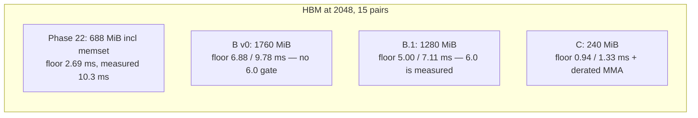
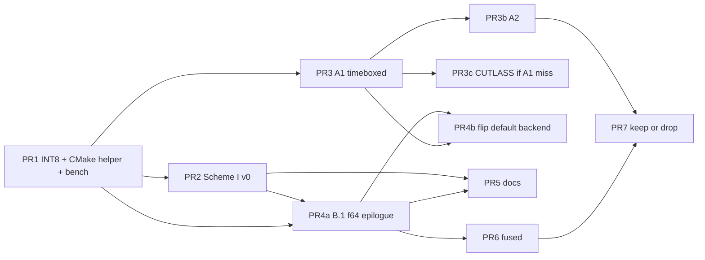

# AdaptiveGEMM Scheme I：Ada INT8 Tensor Core 吃到 ~80% 峰值

| 欄位 | 值 |
|------|----|
| **文件** | SPEC_int8_peak |
| **作者** | AdaptiveGEMM / iThome 系列 |
| **日期** | 2026-08-21 |
| **狀態** | Draft（rev 5） |
| **範圍硬體** | RTX 4060 Laptop, SM 8.9 only（無 TMA / 無 wgmma / 無 TMEM） |
| **對應程式** | `case_2/adaptive_publish_tmp` |
| **相關筆記** | `docs2/int8_gemm.md`, `docs2/io_vs_cublas.md`, `docs2/HANDOVER.md` |

---

## Overview

Phase 22（2-slice Ozaki + 7-prime CRT）在 2048³ `U(-1,1)` 上已贏過 native `cublasDgemm`（~82 ms / 209 GFLOPS），但對上 cuBLAS 13 Ozaki emu **34-bit FIXED**（**3.97 ms / 7.62e-10**）仍慢約 **2.8×**，誤差也差一個數量級（我們 3.40e-9）。瓶頸拆成兩半、不能再混在同一顆 `crt_fast_kernel` 裡修：

1. **Kernel 品質：** 把現況 CRT 牆鐘折成 28 次 INT8 GEMM：CRT **8.86–9.38 ms / 28 ≈ 0.32 ms → ~51–54 TOPS（~43% of 121）**。這是 Barrett + XOR 之後的數字；13.6 ms 時代的 ~40 TOPS / 30% 只當歷史基線。cuBLAS 單顆 INT8 的 ~100 TOPS 是從 DYNAMIC emu 8.5 ms / ~49 GEMM **反推**，**不是**本卡 `cublasGemmEx(CUDA_R_8I)` 實測；Gate A1/A2 對打 cuBLAS INT8 要以 PR1 的 `bench_int8_gemm_vs_cublas` 為準。
2. **演算法 IO：** 我們把 Scheme I 的 2 片 hi/lo 再套 Scheme II 的 7 質數，等於 **28 次** HBM K-sweep；cuBLAS 是純 Scheme I，34-bit → `sliceCount = ceil((34+1)/8) = 5` 張 8-bit slice。Demo 把 34-bit 印成 25 GEMM（`slices*slices`）；本 spec 的速度預設跑 **15 個高權重 pair**（`a+b ≤ 4`）。「對打 3.97 ms」是 **同一 mantissa bit count**，不是同一 GEMM 次數——`cublas.dll` 內部用 15 還是 25 我們看不到。

本文件把「吃滿 INT8 Tensor Core」與「34-bit 端到端靠近 3.97 ms」拆成三個可獨立合併的階段，**不保證第一天就贏 cuBLAS**。成功標準刻意拆開：

| # | 目標 | 門檻 |
|---|------|------|
| 1 | 單獨 s8×s8→s32 GEMM（2048³） | Gate A1：≥70% × 121 **或** ≥90% × **實測** `cublasGemmEx` INT8。Gate A2：≥80% × 121 **或** ≥95% × 該實測。**A2 是標題指標，不是 Scheme I 出貨條件。** |
| 2 | 端到端 34-bit Scheme I | **只有 B.1**（in-tree GEMM + RF 內 INT32→f64 epilogue）才掛 6.0 ms 閘（3.97 × 1.5）。B v0（cuBLAS INT8 + INT32 scratch）**沒有**時間閘。Stretch 4.76 ms 是程式願望，不是 Stage C 成功定義。 |
| 3 | 誤差 | vs native DGEMM max error ≤ **1e-8**，理想 ~**1e-9**。15 pair 與 25 pair 都要報。 |

**誠實結論先寫在前面：**

- fused p=5 要同時拿到「單顆 INT8 GEMM 的 80% 峰值」幾乎不可能——Ada 沒有 TMEM，p² 組 INT32 acc 放不進 RF。Stage C 的成功看 **HBM O(p)** 與 **是否快過量到的 B.1**，不看 tensor pipe 80%，也不看 4.76 ms。
- naive 15-pair 把 INT32 寫回 HBM 再讀（1664 MiB，256 GB/s 下限 **6.50 ms**）**物理上過不了 6.0 ms**。6.0 ms 閘只適用 B.1。Gate A1 **不是** v1 的充分條件：沒有 f64 epilogue，70% MMA 也救不了那 1200 MiB reduce。
- 預設路徑維持 `ExecutionMode::Phase22`，直到 Scheme I 在精度上過關（速度閘另算）。

---

## Background & Motivation

### 現況（必須當基準，不要再拿 Phase 24 的 130 ms 講故事）

同一組資料、同一支 `examples/demo_main.cpp`（2048³、`U(-1,1)`、RTX 4060 Laptop、CUDA 13.0）：

| 路徑 | 時間 | 等效 GFLOPS | vs native | max error vs native |
|------|-----:|------------:|----------:|--------------------:|
| cuBLAS native DGEMM | 82.2 ms | 209 | 1.0× | — |
| Phase 22（XOR swizzle 後） | **10.3–11.2 ms** | ~1540–1660 | ~7.5× | **3.40e-9** |
| cuBLAS emu DYNAMIC | 8.5–8.8 ms | ~1940–2010 | ~9.5× | 2.84e-13 |
| cuBLAS emu **FIXED 34-bit** | **3.97 ms** | ~4330 | ~21× | **7.62e-10** |

第一次 `execute()` 拆帳（`AdaptiveOzakiEngine::execute` 快路徑，`printed_break`）：`pack ~1.66 ms  crt ~8.9–9.4 ms`。`precision_test` 512：max error 1.52e-9，過 1e-8。

已做且量過的微調：

| 改動 | 結果 |
|------|------|
| 拿掉 Phase 24 naive residual | 130 ms → 不再走這條；預設 Phase 22 |
| magic rem + Barrett CRT | 13.6 → 10.9 ms，誤差同一顆元素 |
| XOR smem swizzle、pad 48→64 | 10.9 → 10.3 ms；bank conflict **沒有一次打掉** |
| 預取下一個質數 k=0 | CRT 變慢，**已 revert** |

等效 INT8 TOPS（`2 n³ / (t_crt / 28)`，含 Barrett/ALU，是 MMA issue 的**下限**）：

| 時代 | CRT ms | ms / 28 | 等效 TOPS | vs 121 |
|------|-------:|--------:|----------:|-------:|
| Barrett 前（13.6 ms wall） | ~12.2 | **0.44** | **~40** | ~33% |
| **現況（magic+Barrett+XOR）** | **8.86–9.38** | **0.32–0.33** | **~51–54** | **~43%** |

後文「現況 kernel」一律用 **~54 TOPS / 0.32 ms**。40 TOPS 只出現在歷史表。

### 現在 kernel 實際在做什麼

`execute()` 快路徑（`src/AdaptiveOzaki.cu`，`!do_fp64 && !do_residual`）：

1. `cudaMemsetAsync(dC, 0, …, /*default stream*/ 0)` —— 修過 non-blocking memset 與下一輪 CRT 搶寫、連續 execute 變成 4× 的 bug。
2. `precompute_modulo_hl_A/B`：FP64 → 7 質數 × {hi, lo} INT8，`sh = 2^17`、`sl = 2^34`，寫進 HBM tiled layout。
3. 四次 `crt_fast_kernel<<<dim3((n+63)/64, (m+127)/128), 256>>>`：
   - pass 0: Ah×Bh × 2^{-34}
   - pass 1: Ah×Bl × 2^{-51}
   - pass 2: Al×Bh × 2^{-51}
   - pass 3: Al×Bl × 2^{-68}

`crt_fast_kernel` 只是 `crt_pass_kernel_body<false, false>`（固定 7 質數、C 用 `+=` 非 atomic）。body 裡：

- tile **128×64**，256 threads（8 warp），每 warp **32×32**
- `__shared__ int8_t sa[2][128][64], sb[2][64][64]`，K=32，**2-stage `cp.async`**
- `swizzle_k16(row, col) = col ^ ((row & 3) << 4)`
- 每個質數 **完整掃一次 K**，`mma.sync.aligned.m16n8k32.row.col.s32.s8.s8.s32`
- 每個 K-tile 的 MMA 群組**之前與之後各一次** `__syncthreads`（`AdaptiveOzaki.cu:826-854`），不是每條 `mma.sync` 前後各一次
- 然後 `rem_prime_u32`（`__umulhi` + `d_prime_magic`）與 `barrett_mod_M7`（`M = 168897325606883`，`mu = 109218`）
- `__launch_bounds__(256, 3)`

NCU（舊 `decoupled_crt_pass_kernel`，**不是**現在 e2e）：Tensor (INT) pipe **37.0%**、occupancy **48.10%**、smem bank conflict 仍高（`docs/31_Phase24_26_Performance_Tuning_and_Occupancy.md`）。Residual 拿掉之後，**這顆 MMA 就是主因**。

### 為什麼再調 `crt_fast_kernel` 追不回 2.8×

`docs2/io_vs_cublas.md` 已經寫死：17-bit × 17-bit × K=2048 塞不進 int32（`126*126*2048 = 32.5e6` 只是餘數域的上限；真正 17-bit 整數乘積 ×K 需要 CRT）。cuBLAS 選 8-bit 就是為了「一次 MMA = 一次精確 INT32 GEMM」。我們選 17-bit + CRT 是為了少 slice，結果每次變肥、HBM 次數反而更多。

繼續微調 Barrett / swizzle / prefetch 是在優化一條比較貴的 Scheme II。本 spec 換 Scheme I。

---

## Goals & Non-Goals

### Goals

- **Stage A：** 獨立 s8×s8→s32 GEMM kernel，2048³ 對打 **實測** `cublasGemmEx(CUDA_R_8I, CUBLAS_COMPUTE_32I)`。不混 CRT、不混 Ozaki packing。PR1 交出**一顆可實作的 template kernel**（正確性）；80% 是 Gate A2 / PR3b 的研究閘，不是 PR1 的契約。
- **Stage B v0：** Scheme I host + `cublasGemmEx` INT8 + INT32 scratch。多次 launch。**正確性閘 only**（err ≤ 1e-8）。cuBLAS INT8 epilogue 是 INT32，這條路 **必然** 把 INT32 寫回 HBM，**不掛 6.0 ms**。
- **Stage B.1：** in-tree GEMM，INT32 acc 留在 RF，epilogue 直接 `C_f64 += …`。仍是 **每 pair 一次 launch**。這才是 6.0 ms 閘的載具。
- **Stage C：** 一顆 kernel，沿 K 載入 slice 一次，on-chip acc，C 寫一次。成功 = 快過量到的 B.1 **且** HBM O(p)。
- Phase 22 CRT 路徑保持可跑、可測、**仍是 default**。
- `ExecutionMode` / Python `mode=` 可 A/B。
- Demo 印出 INT8 TOPS 與 vs `cublasGemmEx` INT8（PR1 起強制 `--int8-bench`）。

### Non-Goals

- 本 spec **不管** Hopper/Blackwell（wgmma、TMA、TMEM）。
- 不管贏 cuBLAS DYNAMIC / 1e-13。
- 不管把 Phase 24 residual 加回來衝 1e-15。
- 不管第三片 17-bit（pass 4→9）。
- 不管改 `crt_fast_kernel` 去「順便」吃 80%。
- 不管在還沒對答案前把 swizzle 當唯一 PR。
- 不管把 CMake 從「自訂 nvcc 編譯 `.cu.obj`」一次重寫成 `enable_language(CUDA)`。
- 不管任意 `m,n,k`（v1 契約：`m % BM == 0`、`n % BN == 0`、`k % BK == 0`；非對齊是後續 PR。`<128,128,64,3>` 上即 128 / 128 / 64）。

---

## Hardware Budget（sm_89 / 4060 Laptop）

NCU CSV 與 `cudaGetDeviceProperties` 對得上：`NVIDIA GeForce RTX 4060 Laptop GPU`，SM 8.9，24 SM，1536 threads/SM，65536 regs，L2 24 MB，max shared **101376 B**。

| 項目 | 值 | 來源 / 用法 |
|------|----|-------------|
| GPU | RTX 4060 Laptop, AD107 | demo `cudaGetDeviceProperties` |
| SM | 8.9，**24** SM | Ada 128 CUDA cores/SM → 3072 cores |
| L2 | **24 MB** | 2048² INT8 A+B+C_i32 = 4+4+16 = 24 MB，剛好貼齊 |
| HBM | 128-bit × 16 Gbps ≈ **256 GB/s** 理論 | **規劃用 ~180 GB/s**（laptop TGP derate）。下限公式仍報 256。 |
| SMEM / SM | **101376 B** | fused slice 的硬上限 |
| Registers / SM | 65536 | occupancy 計算器 |
| Max threads / SM | 1536 | Ada |
| INT8 MMA | `mma.sync.aligned.m16n8k32.row.col.s32.s8.s8.s32` | 4096 MAC = 8192 ops / 指令 |
| 非同步拷貝 | `cp.async.cg.shared.global` 16B | Ampere+，**沒有** TMA |
| Dense INT8 峰值 | **~121 TOPS** | 廣告 sparse ~242 的一半；**不是**本卡時脈實測 |

單一 2048³ INT8 GEMM：`2 n³ = 17.180e9` ops。

| 吞吐 | 時間 | 備註 |
|------|-----:|------|
| 121 TOPS（100% 理論） | **0.142 ms** | 下限 |
| 97 TOPS（80% 理論） | **0.177 ms** | Gate A2 |
| 85 TOPS（70% 理論） | **0.202 ms** | Gate A1 |
| ~54 TOPS（現況 CRT 等效） | **0.32 ms** | 8.9 ms / 28 |
| ~40 TOPS（Barrett 前） | **0.43 ms** | 歷史 |
| cuBLAS INT8 | **PR1 才量** | 在那之前禁止寫成「本卡天花板 100 TOPS」 |

Roofline（理論 HBM 256 GB/s）：ridge ≈ 121e12 / 256e9 = **473 ops/byte**。整題 2048³、C 寫 INT32：traffic 24 MB → AI = 17.18e9 / 24e6 = **716 ops/byte > ridge**，**整題是 compute-bound**。所以現況 ~43% 不是 HBM 不夠，是 tiling / pipeline / 佔用率。

CTA 若只有 128×64 且不靠 L2 重用：AI = `2·128·64 / (128+64)` = 85.3 MAC/byte = 171 ops/byte **< ridge**。8 MB operand 進得了 24 MB L2；NCU 仍顯示 tensor pipe 37%，代表 L2 救不了 issue rate。

**操作型峰值：** 同時報「vs 121 TOPS」與「vs 同尺寸實測 `cublasGemmEx` INT8」。laptop TGP 不穩時，**對打 cuBLAS INT8 優先於理論 121**。Demo 開頭加印 `prop.memoryBusWidth`、`clockRate`、`sharedMemPerMultiprocessor`，避免 121/256 凍死在 SKU 表。

---

## Proposed Design

### 總架構

三個**互斥**的 Scheme I 成品，不要混著排預算：

```text
B v0     execute_scheme_i_v0
         cuBLAS INT8 + INT32 scratch 落地 + accumulate_i32_to_f64
         15 launch，1664 MiB，無 6.0 ms 閘

B.1      int8_gemm_s8s8s32_f64_epilogue × 15
         in-tree only；INT32 留 RF；每 launch 寫/加 C_f64
         6.0 ms 閘掛這裡

C        scheme_i_fused
         1 launch，p slices 沿 K 讀一次，C 寫一次
         成功 = 快過量到的 B.1 且 HBM O(p)
```


建議實作順序：PR1（正確 INT8 GEMM + CMake 多 `.cu` 模式 + `--int8-bench`）先合；PR2（B v0）**rebase 在 PR1 的 CMake helper 上**，只加 `scheme_i.cu.obj`。B v0 **不**證明 6.0 ms。B.1 的 f64 epilogue（PR4a）不等人家 70%。C 在 B.1 有誤差錨之後。

### Stage A — 孤立 INT8 GEMM

這是 Triton/CUTLASS 問題，**不要從 `crt_pass_kernel_body` 長出來**。那份 template 綁了質數迴圈、`final_weighted_sum[2][4][4]` uint64、CRT tiled layout、N=64、2-stage。

**80% 峰值是 Gate A2 的搜尋結果，不是 PR1 寫得下來的契約。** PR1 只交下面這一顆具體 kernel。

#### PR1 契約 kernel（可直接實作）

Compile-time template，**不是** runtime `Int8GemmConfig`：

```cpp
// include/int8_gemm.h
namespace ozaki {

// v1 alignment contract: m % BM == 0, n % BN == 0, k % BK == 0.
// (BK, not MMA-k=32: the K loop steps by BK.)
// PR1 instantiates exactly one kernel: <128,128,64,3>.
template<int BM, int BN, int BK, int Stages>
void int8_gemm_s8s8s32_launch(const int8_t* A, const int8_t* B, int32_t* C,
                              int m, int n, int k, cudaStream_t stream);

inline void int8_gemm_s8s8s32(const int8_t* A, const int8_t* B, int32_t* C,
                              int m, int n, int k, cudaStream_t stream) {
    int8_gemm_s8s8s32_launch<128, 128, 64, 3>(A, B, C, m, n, k, stream);
}

// B.1 only (PR4a). Not used by the cuBLAS backend.
// row_sum / col_sum / bias_* match accumulate_i32_to_f64 (B v0).
// Compensation is applied ONCE after the full-K MMA, not per BK tile:
//   acc_u = acc_mma + bias_b*row_sum[i] + bias_a*col_sum[j] + bias_a*bias_b*k
//   C[i,j] += ldexp((double)acc_u, eA[i] + eB[j] + slice_shift)
void int8_gemm_s8s8s32_f64_epilogue(
    const int8_t* A, const int8_t* B, double* C,
    const int32_t* eA, const int32_t* eB,
    const int32_t* row_sum, const int32_t* col_sum,
    int bias_a, int bias_b, int m, int n, int k, int slice_shift,
    cudaStream_t stream);

struct Int8GemmBench {
    double our_ms, cublas_ms, our_tops, cublas_tops, peak_frac, vs_cublas;
};
Int8GemmBench bench_int8_gemm_vs_cublas(int m, int n, int k);
} // namespace ozaki
```

沒有 runtime `{bm,bn,bk,stages}` struct，因為 `__shared__ int8_t sa[Stages][BM][BK]` 必須是編譯期常數。PR3 若要掃 tile，**加 template 實例**（例如 `<128,256,64,3>`）與一個 compile-time 表，由 host 用 `if (n % 256 == 0)` 選 launch，不是把 tile 當 kernel 參數。

沒有 `int8_gemm_s8s8s32_accum`（beta=1 寫 INT32 C）——那是錯誤的 B.1 epilogue。

cuBLAS 對照（與 demo 同一套 row-major 技巧：`C=A*B` ≡ column-major `C=B*A`）：

```cpp
int32_t alpha = 1, beta = 0;
cublasGemmEx(h, CUBLAS_OP_N, CUBLAS_OP_N, n, n, n,
             &alpha, d_B, CUDA_R_8I, n, d_A, CUDA_R_8I, n,
             &beta, d_C, CUDA_R_32I, n,
             CUBLAS_COMPUTE_32I, CUBLAS_GEMM_DEFAULT_TENSOR_OP);
```

#### Warp / smem / 管線（`<128,128,64,3>`，256 threads = 8 warps）

| 項 | 值 |
|----|----|
| CTA | BM=128, BN=128, BK=64 |
| Threads | 256（8 warps） |
| Warp map | `wm = wid / 2`（0..3）、`wn = wid % 2`（0..1）→ warp tile **32×64**。`ms = wm*32`，`ns = wn*64` |
| C acc / thread | 32×64 / 32 = **64 INT32** |
| MMA / warp / K=32 | 2×8 次 `m16n8k32`（M 方向兩個 16、N 方向八個 8） |
| Stages | 3 |

**Gmem layout：** A、B 都是 **row-major** `A[m,k]`、`B[k,n]`，與 `cublasGemmEx` 共用。

**Smem：**

- A：`int8_t smem_A[Stages][BM][k_stride]`，`k_stride = 128`（BK=64 資料 + 64 B pad）。Gmem A 的 K 連續，`cp.async` 16 B 沿 K。
- B：`int8_t smem_B[Stages][BK][n_stride]`，`n_stride = 128`。Gmem B 的 N 連續，`cp.async` 16 B 沿 N。**`ldmatrix.sync.aligned.m8n8.x2.trans`** 把 `[k,n]` 轉成 `mma.row.col` 要的 K-major B fragment。這是對 `get_B8_offset` 那種已 K-contiguous 的 CRT layout 的明確替換——新 kernel **不做** gmem 轉置。

Pad 到 128 B 是為了下面這組 XOR（64 B 行寬配 `(row&7)<<4` 會把 col xor 到 ≥64）。

**XOR swizzle（A 的 K 維、B 的 N 維同一函數，domain 不同）：**

```cpp
// col_b: 16-byte aligned offset in the *logical* row.
// A: col_b ∈ [0, BK)  into stride 128  (BK=64 data, 64 B pad)
// B: col_b ∈ [0, BN)  into stride 128  (BN=128, no pad — includes 64..127)
// 16-byte XOR, 8-row period. Used by both cp.async store and ldmatrix addr.
__device__ int swizzle_16B_8row(int row, int col_b) {
    return col_b ^ ((row & 7) << 4);
}
```

同一函數。下表是 8 個 16 B chunk 裡的 **前四個** `{0,16,32,48}`。B 的後四個是 `64+{0,16,32,48}`，xor 進同一 128 B 行（例如 row 4、col_b=64 → 0）**不碰撞**，因為 A 的「列」是 M、B 的「列」是 K-row，索引空間不同。實作若把 domain 當成 `[0,64)`，N 的 64..127 會維持線性——這正是這節要擋的 bank-conflict。

16-row 數值例（`col_b = 0, 16, 32, 48`；B 另加 `64, 80, 96, 112` 走同一 xor）：

| row | xor | 0 | 16 | 32 | 48 | 64 | 80 | 96 | 112 |
|----:|----:|--:|---:|---:|---:|---:|---:|---:|----:|
| 0 / 8 | 0 | 0 | 16 | 32 | 48 | 64 | 80 | 96 | 112 |
| 1 / 9 | 16 | 16 | 0 | 48 | 32 | 80 | 64 | 112 | 96 |
| 2 / 10 | 32 | 32 | 48 | 0 | 16 | 96 | 112 | 64 | 80 |
| 3 / 11 | 48 | 48 | 32 | 16 | 0 | 112 | 96 | 80 | 64 |
| 4 / 12 | 64 | 64 | 80 | 96 | 112 | 0 | 16 | 32 | 48 |
| 5 / 13 | 80 | 80 | 64 | 112 | 96 | 16 | 0 | 48 | 32 |
| 6 / 14 | 96 | 96 | 112 | 64 | 80 | 32 | 48 | 0 | 16 |
| 7 / 15 | 112 | 112 | 96 | 80 | 64 | 48 | 32 | 16 | 0 |

`ldmatrix` 位址必須走**同一個** `swizzle_16B_8row`。這組公式是 PR1 的契約；PR3 若換成別的 mask，要帶一張同樣含 64..127 的表。

SMEM 用量：A 3×128×128 = 48 KB，B 3×64×128 = 24 KB，合計 **72 KB** → 1 CTA/SM（101376 B 上限）。Occupancy 256/1536 ≈ 17%。靠 64 個 INT32 acc 的 ILP，不靠 3 CTA。

**`cp.async` wait：** 現有 `cp_async_wait_0/1`（`AdaptiveOzaki.cu:16-21`）不夠 3-stage。Helper 只搬 PTX，**不含** `get_A8_offset` / `get_B8_offset` / `swizzle_k16` / `fp64_hi`（那是 CRT layout，L27–55）：

```cpp
// include/mma_sm89.cuh  — 從 AdaptiveOzaki.cu 只搬 9–21 與 57–81
template<int N>
__device__ __forceinline__ void cp_async_wait() {
    asm volatile("cp.async.wait_group %0;\n" :: "n"(N));
}
```

3-stage 主迴圈用 `cp_async_wait<Stages-2>()` → `wait_group 1`。

**RF fragment 雙緩衝（80% 的必要條件，PR1 就要寫上，即使還沒 80%）：** 必須覆蓋 warp 的 **2×8** 次 `m16n8k32`，不是一顆 16×8：

```cpp
uint32_t a_frag[2][2][4]; // pipe × M-mma (2×16) × ldmatrix.x4
uint32_t b_frag[2][8][2]; // pipe × N-mma (8×8) × ldmatrix.x2.trans
```

A 用 `ldmatrix.sync.aligned.m8n8.x4`（無 .trans）；B 用 `ldmatrix.sync.aligned.m8n8.x2.trans`。Lane→smem 走與 store 相同的 `swizzle_16B_8row`（PTX m8n8.x4 的 8×8 子塊對應）。禁止 `a_frag[2][4]`（那只有 1 個 M-mma，算出 16×8 不是 32×64）。

**CTA raster（PR1 先不做）：** `grid = dim3(n/BN, m/BM)`，`blockIdx.x` = N tile、`blockIdx.y` = M tile。PR3 才加 L2 swizzle：`int n_tile = blockIdx.x ^ (blockIdx.y & 7)`（`n/BN` 為 8 的倍數時；2048/128=16，OK）。這是常被拿來追最後 10–20% vs cuBLAS 的那一招，不在 PR1 正確性範圍。

**Inner loop：**

```text
prologue: cp.async stages-1 K-tiles, commit
          wait, syncthreads
          ldmatrix.x4  A → a_frag[0][0..1]
          ldmatrix.x2.trans B → b_frag[0][0..7]
          p = 0
for k0 in 0..K step BK:
    prefetch k0+(stages-1)*BK into smem[write]
    cp_async_wait<Stages-2>()
    __syncthreads()
    for k1 in 0..BK step 32:
        # Next MMA-k into frag[p^1]. BK=64 ⇒ k1∈{0,32}.
        # k1=32 is k=64 = first MMA-k of the NEXT BK tile — not in smem[read].
        # Skip is every BK tile, not only last k0.
        if k1 + 32 < BK:
            src = smem[read];   k_off = k1+32     # same BK tile
        elif k0 + BK < K:
            src = smem[read+1]; k_off = 0         # next BK, already wait_group 1
        else:
            src = null                            # last k1 of last k0
        if src:
            ldmatrix.x4        src A, k_off → a_frag[p^1][0..1]
            ldmatrix.x2.trans  src B, k_off → b_frag[p^1][0..7]
        for i in 0..1:
          for j in 0..7:
            mma.sync.m16n8k32 a_frag[p][i], b_frag[p][j], acc[i][j]
        p ^= 1
    rotate smem stages
    __syncthreads()                         # once per BK tile, not per mma
epilogue: st.global.v4 INT32 C, 128×128
```

**Split-K：** `K_max ≈ 2^31/(127*127) ≈ 1.33e5`。2048 遠低於。v1 不做 split-K；`m % BM`、`n % BN`、`k % BK` 任一不成立 **直接 `cudaErrorInvalidValue`**（對齊契約，不 silent pad）。`<128,128,64,3>` 上 n=32 必須走這條 error，不當 CPU gold。

#### 為什麼現況 128×64 / 2-stage 吃不滿

- 8 warp × 2×4 `mma.m16n8k32` = 64 MMA / K-step；N=64 讓 CTA AI 低於 ridge
- **每個 K-tile MMA 群組**前後 `__syncthreads`（不是每條 MMA），加上 bank conflict、2-stage 只提前 32 的 K
- 質數之間重跑 K，pipeline 被 CRT 打斷（Stage A 沒有這段）
- inner loop 沒有 RF 雙緩衝

#### Tile 掃描（PR3 / PR3b，不是 PR1）

| CTA tile | stages | SMEM A+B（含 128 B stride） | CTA/SM | 備註 |
|----------|--------|------------------------------|--------|------|
| 128×64×32 CRT | 2 | 24 KB | 3 | 不要當 Stage A 起點 |
| **128×128×64** | **3** | **72 KB** | **1** | **PR1 唯一實例** |
| 128×256×64 | 3 | ~96 KB | 1 | PR3 候選；warp 改 2×4 的 64×64，128 i32/thread |
| 128×128×128 | 3 | smem 滿 | 1 | PR3b |

#### 正確性閘

`tests/int8_gemm_test.cpp`（CMake 做成與 `adaptive_gemm_precision_test` 一樣的 **獨立 executable**）：

- CPU gold：**n = 128 與 512**（可選 256），隨機 s8，`int32` 三重迴圈。**禁止** 2048³ CPU 金標（~8e9 MAC）。**禁止 n=32 當 gold**——對 `<128,128,64,3>` 它同時違反 `m%128`、`n%128`、`k%64`。
- **負測：** 32³（以及任一 `k % BK != 0`）必須回 `cudaErrorInvalidValue`，不准 pad 後默算。
- vs `cublasGemmEx` INT8：**bit-exact**。n=128/512 放這個測試；n=2048 放 `int8_gemm_perf`（self-hosted）。
- 非對齊 `m,n,k`：v1 **out of contract**（負測除外）。
- 速度失敗不讓 `precision_test` 紅。

每個新 launch 之後 `CHECK_CUDA(cudaGetLastError())` + 測試末 `cudaDeviceSynchronize`。

### Stage B — Scheme I host

開源對照 ozIMMU：`split_AB_int8` → loop INT8 GEMM → `accumulate_in_f64`。cuBLAS 產品化細節不公開。34-bit、p=5。

#### 數學與 pair 枚舉

`p = ceil((mantissaBitCount + 1) / 8)`；34-bit → **p = 5**。

三角是 **丟掉低權重 pair**，不是矩陣三角。`A_a B_b ≠ A_b B_a`。

0-based `a,b ∈ {0,1,2,3,4}`：

| 條件 | pair 數 |
|------|--------:|
| `a+b ≤ 3` | 10 |
| **`a+b ≤ 4`** | **15 = p(p+1)/2** |
| `a+b ≤ 5` | 19 |
| 無（p²） | 25 |

**預設 `scheme_i_pair_threshold = 4`。** 舊稿寫 T=5 → 15 pair 是算錯（那是 19）。Host 用同一個 enumerator：

```cpp
inline int scheme_i_for_each_pair(int p, bool triangular, int T,
                                  const std::function<void(int a, int b)>& fn) {
    int n = 0;
    for (int a = 0; a < p; ++a)
      for (int b = 0; b < p; ++b)
        if (!triangular || a + b <= T) { fn(a, b); ++n; }
    return n;
}
```

單測：`p=5, triangular=true, T=4` → 15；`T=5` → 19；`triangular=false` → 25。Demo 印 `pairs_launched`。

滿 25 pair 是**精度 oracle**，不當速度預設。

**不要**用 Phase 22「只做 Ah×Bh 一 pass ≈ 1e-9」當 Scheme I 可丟 pair 的證據。那是 17-bit Ozaki 四片裡的 hi×hi，權重遠大於 8-bit stack 的 `(a,b)=(4,4)`。PR2 必須在同一 2048³ `U(-1,1)` **以及** 一組 mixed-magnitude（列/欄 `max |A|` 差到 ~2^8）上報 15 vs 25 的 max error，**之後**才凍結 T。在那之前 T=4 只是速度預設，CI 兩種都跑。

「公平賽 vs 3.97 ms」= 鎖 `MaxMantissaBitCount=34`。Demo 把 34-bit 印成 25 GEMM；cuBLAS 實際 launch 數未知。15 pair 對時間更鬆、對誤差更緊。

INT32 不溢位：`127*127*2048 = 33,014,048 < 2^31-1`。Zero-pointed 下 `|s8|≤127` 仍成立；補償項 `128*row_sum` 走 INT64 或直接 f64。

#### Digit encoding（s8 MMA 可重建）——必做、有黃金例

`mma.sync.s32.s8.s8.s32` 與 `CUDA_R_8I` **只吃有號 s8**。若每片都當 s8 解讀 2's complement 的 raw byte，`q = -1`（16-bit）的兩片 `[-1,-1]` 乘出來是 66049 不是 1。

**選定編碼：MSB（slice 0）有號 s8；其餘片 unsigned digit zero-point 進 s8。**

整數 `q = round(ldexp(A, -eA) * 2^{mantissa_bits})`，放進 8p-bit 2's complement 容器（p=5 → 40 bit）：

```text
q = Σ_{s=0..p-1} u_s * 2^{8*(p-1-s)}
u_0 ∈ [-128,127]          # MSB, 直接存成 int8
u_s ∈ [0,255]  (s≥1)      # 低片，存 S_s = (int8_t)(u_s - 128)
```

算術右移抽 MSB：`u_0 = (int8_t)(q >> 8*(p-1))`。低片：`u_s = (q >> 8*(p-1-s)) & 0xFF`（logical 8-bit）。

GEMM 看到的是 S，不是 u。對 pair (a,b)：

```text
bias_a = (a == 0) ? 0 : 128
bias_b = (b == 0) ? 0 : 128
Σ_k (S_a + bias_a)(S_b + bias_b)
  = Σ S_a S_b + bias_b Σ S_a + bias_a Σ S_b + bias_a * bias_b * K
```

`Σ S_a S_b` 是 s8 MMA。補償：每張 slice 預先算 `row_sum_A[a][i] = Σ_k S_a[i,k]`、`col_sum_B[b][j] = Σ_k S_b[k,j]`（pack 時順手，int32）。Epilogue：

```text
acc_u = acc_mma
      + bias_b * row_sum_A[a][i]
      + bias_a * col_sum_B[b][j]
      + bias_a * bias_b * k
```

若 a=b=0（兩張 MSB），bias=0，補償為 0。

**Scale：** `eA[i]`、`eB[j]` 是 **int32 指數**，不是 double scale。

```text
eA[i] = (max_j |A[i,j]| == 0) ? 0 : ceil(log2(max_j |A[i,j]|))
x     = ldexp(A[i,j], -eA[i])          # 除法，映到約 [-1,1]
q     = round(x * 2^{mantissa_bits})
```

**精確 shift（MSB-first，p、mantissa_bits 固定）：**

```text
slice_shift(a,b) = 8 * ((p - 1 - a) + (p - 1 - b)) - 2 * mantissa_bits
C[i,j] += ldexp((double)acc_u, eA[i] + eB[j] + slice_shift(a,b))
```

p=5、mantissa=34、hi×hi (0,0)：`slice_shift = 8*(4+4) - 68 = -4`。U(-1,1) 且 e=0 時 hi×hi 貢獻 `acc * 2^{-4}`。這不是 typo：40-bit 容器的頂片權重 2^{32}，兩個 34-bit q 的乘積權重相對 2^{68} 差 2^4。

**1-element golden（CPU int64，PR2 必測）：**

p=2，mantissa_bits=8（16-bit 容器），K=1，eA=eB=0。`q=-1` 的位元是 `0xFFFF`：MSB s8 = -1，低片 unsigned 255 → 存 `S=127`。

`qA=qB=-1` 四個 pair（`slice_shift(a,b)=8*((1-a)+(1-b))-16`）：

| pair (a,b) | u_a, u_b | S_a, S_b | acc_u（MMA+bias） | slice_shift | ldexp(acc_u, shift) |
|------------|----------|----------|-------------------|------------:|---------------------|
| (0,0) hh | -1, -1 | -1, -1 | 1 | 0 | 1 |
| (0,1) hl | -1, 255 | -1, 127 | -255 | -8 | -255/256 |
| (1,0) lh | 255, -1 | 127, -1 | -255 | -8 | -255/256 |
| (1,1) ll | 255, 255 | 127, 127 | 65025 | -16 | 65025/65536 |

四項之和 = `1 - 255/256 - 255/256 + 65025/65536` = **2^{-16}** = `qA*qB * 2^{-16}`。`(1,1)` 的 bias 補償：`127*127 + 128*127 + 128*127 + 128*128*1 = 65025`。

同測 `qA=qB=+1` 與 `qA=-1,qB=+1`。p=5、K=1、`q=±1` 用同一 `slice_shift` 公式對 CPU `int64 qA*qB` 再 `ldexp(..., -2*mantissa_bits)`。hi×hi 單項可以是 O(1)（權重 2^{64}×2^{-68}=2^{-4} 在 p=5），四項/二十五項之和才是 `qA*qB * 2^{-2*mantissa}`——測試要比**加總**，不要單 pair 對 `qA*qB`。

#### Pack kernels（四顆：reduce max-abs → exponents → write slices）

Header **只放 `include/scheme_i.h`**。`AdaptiveOzakiEngine::execute` include 它再 dispatch。不要在 `AdaptiveOzaki.h` 再 fork 一份 private 宣告。

**禁止對 exponent 做 `atomicMax`。** 空 K-tile 若寫 `e=0`（全 0 列慣例），而另一 tile 寫 `ceil(log2(0.4))=-1`（`log2(0.4)≈-1.322`），`atomicMax` 得到 0 不是 -1。`max(ceil(log2 a), ceil(log2 b)) == ceil(log2(max(a,b)))` 只在空 tile **不**以 0 參與時成立。U(-1,1) 藏得住（e≈0）；mixed-magnitude 會把 `(0,1)` 的列過度放大。`e=-2` 會把 0.4 縮成 1.6，超出 `[-1,1]`。

契約：reduce **raw** `max |x|`（`double`，初值 **0.0**，空 tile 貢獻 0.0 = 非負 max 的單位元），**global max 存在之後才做一次** `ceil(log2)`。

```cpp
// Pass 1: max |x| only. Init maxA[m], maxB[n] to 0.0. Never write slices or e*.
// A: grid (row_tiles,) — each CTA owns rows, scans full K, stores maxA[i]. No atomic.
// B: grid (col_tiles, k_tiles) — per-column max-abs on this K-slice, then
//    IEEE-754 bit atomicMax into maxB[j] (non-negative doubles: max bits == max value).
__global__ void scheme_i_reduce_maxA(const double* A, double* maxA, int m, int k);
__global__ void scheme_i_reduce_maxB(const double* B, double* maxB, int k, int n);

// After max* are complete. e = (x==0) ? 0 : (int)ceil(log2(x)).
__global__ void scheme_i_exponents_from_max(const double* maxAbs, int32_t* e, int n);

// Pass 2: eA/eB complete. Write p planes + row_sum / col_sum.
__global__ void scheme_i_write_slices_A(const double* A, const int32_t* eA,
    int8_t* slices, int32_t* row_sum, int m, int k, int p, int mantissa_bits);
__global__ void scheme_i_write_slices_B(const double* B, const int32_t* eB,
    int8_t* slices, int32_t* col_sum, int k, int n, int p, int mantissa_bits);
```

Host：`cudaMemset(maxA/maxB, 0)` → `reduce_maxA` / `reduce_maxB` → `exponents_from_max` → `write_slices_A/B`。Slice 與 max **不同 launch**。B 的 gmem 是 strided in K（`B[k*n+j]`）。

若有人堅持 combine exponents：初值必須是 `INT_MIN`（「無資料」），空 tile 不寫，最後 `INT_MIN → e=0`。**預設路徑不走這條**——raw max-abs 比較難寫錯。

Pack 單測（PR2）：一欄 `max=0.4` 且後面一長串 0 → `eB=-1`（`ceil(log2(0.4))`），不是 0，也不是 `floor` 的 -2。另測 `max=0.5 → eB=-1`、`max=1.0 → eB=0`，避免 ceil/floor 混淆。全 0 欄 → `eB=0`。縮放檢查：`ldexp(0.4, -(-1))=0.8 ∈ [-1,1]`。

`eA`/`eB` 仍只以 int32 存在；`maxA`/`maxB` 是 reduce scratch（double，2048³ 約 32 KB）。

#### Workspace

`allocateWorkspace` 重配條件：`(m, n, k, mode)` 任一變就 `freeWorkspace` + 重配。

Scheme I **禁止**配置 `dA8_h/l`、`dB8_h/l`、`dmA_*`、`dmB_*`、split f32/f64。Debug：第一次 allocate 印 workspace bytes；測試可用 `cudaMemGetInfo` 前後差，或 engine 上的 `workspaceBytes()` getter。

`vram_limit_mb` 現況在 `allocateWorkspace` **沒有 enforce**。Scheme I 維持 advisory：若 slices+scratch > `vram_limit_mb` 則 `std::cerr` + `cudaErrorMemoryAllocation` 失敗，**第一次**真正讀這個欄位。

2048³、p=5：

| buffer | 大小 | B v0 | B.1 / C |
|--------|------|------|---------|
| A_slices | 20 MiB | ✓ | ✓ |
| B_slices | 20 MiB | ✓ | ✓ |
| maxA, maxB | ~32 KB double | ✓ | ✓ |
| eA, eB | ~16 KB | ✓ | ✓ |
| row_sum, col_sum | ~80 KB | ✓ | ✓ |
| C_i32 scratch | 16 MiB | ✓ | **不配** |
| **合計** | | **~56 MiB** | **~40 MiB** |

對比 Phase 22：7×2×(4+4)= **112 MiB** 餘數。

#### 三條 host 路徑

```cpp
// B v0 — PR2. No 6.0 ms claim. INT32 lands.
void execute_scheme_i_v0(...);

// B.1 — PR4a. In-tree kernel only. INT32 never stored.
// execute() calls this when mode==SchemeI && !use_cublas && !fused.
void execute_scheme_i_b1(...);

// C — PR6. scheme_i_fused==true.
void execute_scheme_i_fused(...);
```

B v0 迴圈：

```cpp
cudaMemsetAsync(dC, 0, (size_t)m * n * sizeof(double), stream);
cudaMemset(maxA/maxB, 0);  // identity for max |x|
scheme_i_reduce_maxA<<<...>>>(...);
scheme_i_reduce_maxB<<<...>>>(...);
scheme_i_exponents_from_max<<<...>>>(maxA, eA, m);
scheme_i_exponents_from_max<<<...>>>(maxB, eB, n);
// eA/eB must be complete before any slice is written
scheme_i_write_slices_A<<<...>>>(...);
scheme_i_write_slices_B<<<...>>>(...);
CHECK_CUDA after each launch;
int launched = scheme_i_for_each_pair(p, triangular, T, [&](int a, int b) {
    cublasGemmEx(/* A_slices[a], B_slices[b] → dC_i32, beta=0 */);
    int sh = 8 * ((p - 1 - a) + (p - 1 - b)) - 2 * mantissa_bits;
    accumulate_i32_to_f64<<<...>>>(dC, dC_i32, eA, eB,
                                   row_sum+a*m, col_sum+b*n,
                                   a==0?0:128, b==0?0:128, m, n, k, sh);
});
```

`scheme_i_use_cublas_int8=true` **永遠**走 v0。Key Decision 9 的「INT32 不落地」**cuBLAS backend 做不到**（INT8 epilogue 是 INT32）。不要在 v0 路徑假裝 B.1。

B.1 迴圈：同一 enumerator。無 `dC_i32`。補償在 **full-K MMA 之後一次**（B.1 = 一 pair = 完整 K），參數與 B v0 的 `accumulate_i32_to_f64` 對齊：

```cpp
int launched = scheme_i_for_each_pair(p, triangular, T, [&](int a, int b) {
    int sh = 8 * ((p - 1 - a) + (p - 1 - b)) - 2 * mantissa_bits;
    int8_gemm_s8s8s32_f64_epilogue(
        A_slices[a], B_slices[b], dC, eA, eB,
        row_sum + a * m, col_sum + b * n,
        a == 0 ? 0 : 128, b == 0 ? 0 : 128,
        m, n, k, sh, stream);
});
```

`scheme_i_use_cublas_int8` 預設 **true**，直到 Gate A1 **且** PR4a 誤差綠才在 PR4b 改 false。A2 不是這個 flip 的條件。

### 端到端預算（三欄互斥）

符號：traffic 用文件慣例 MiB，`floor_256 = MiB/256` ms，`plan_180 = MiB/180` ms。  
`wall ≥ max(HBM_floor, MMA_ms) + pack_ALU_unhidden + launch`。  
Pack 的 HBM 已計入 traffic；`pack_ALU` 只計 pack 比 HBM 多出來的算力（規劃 +0.3 ms）。Launch WDDM ~20 µs × N。

Pack 是兩遍讀 FP64（reduce max-abs + write slices）：`2×64 + 40 = 168 MiB`，不是單遍 104。不把 reduce 算進 L2 命中（A+B 32 MiB vs L2 24 MB，樂觀）。memset C 另計 32 MiB write（B v0/B.1 有；C 被「C 寫一次」取代）。

#### B v0（15 pair，INT32 scratch）— 無 6.0 ms 閘

| 步驟 | MiB |
|------|----:|
| pack + memset C | 168+32=200 |
| 15 × (A8+B8 讀 + C_i32 寫) | 15×24=360 |
| 15 × (C_i32 讀 + C_f64 RMW) | 15×80=1200 |
| **總** | **1760** |

| BW | HBM floor | MMA @54 TOPS | MMA @70% | MMA @80% | wall ≥ max(HBM,MMA)+0.3 |
|----|----------:|-------------:|---------:|---------:|-------------------------:|
| 256 GB/s | **6.88 ms** | 4.80 | 3.03 | 2.66 | **≥ 7.2 ms** 任何 MMA |
| 180 GB/s | **9.78 ms** | 同上 | 同上 | 同上 | **≥ 10.1 ms** |

**B v0 過不了 6.0 ms。** Gate A1 與這欄無關。

#### B.1（15 launch，INT32 在 RF，每 launch RMW C_f64）

| 步驟 | MiB |
|------|----:|
| pack + memset C | 200 |
| 15 × (A8+B8) | 120 |
| 15 × C_f64 RMW | 15×64=960 |
| **總** | **1280** |

| BW | HBM floor | MMA @54 TOPS | MMA @70% | MMA @80% | wall 規劃 |
|----|----------:|-------------:|---------:|---------:|----------:|
| 256 GB/s | **5.00 ms** | 4.80 | 3.03 | 2.66 | max(5.00, MMA)+0.3 → **5.3 ms** |
| 180 GB/s | **7.11 ms** | 4.80 | 3.03 | 2.66 | **≥ 7.4 ms** |

結論：

- 6.0 ms 閘 **只掛 B.1**。
- 理論 256 GB/s 上 HBM 已是 ~5.0 ms，MMA 70% 被 HBM 蓋住；**Gate A1 不是 v1 充分條件**。180 GB/s 規劃值下 B.1 下限 7.4 ms **超過 6.0**，要麼實測有效頻寬比 180 好，要麼減少 C RMW（更少 pair / 融成 C）。
- 因此 6.0 ms 是 **量測閘**。紙上能說的只有：B v0 不可能；B.1 在 256 GB/s 有機會；180 GB/s 沒機會除非 L2。

#### C（1 launch）

| 步驟 | MiB |
|------|----:|
| pack（兩遍 FP64） | 168 |
| 5×(A8+B8) 沿 K 一次 | 40 |
| C FP64 寫一次 | 32 |
| **總** | **240** |

HBM floor：256 → **0.94 ms**；180 → **1.33 ms**。Compute 見 Stage C 節，**不用 80% × 0.177**。



### Feature flag

```cpp
enum class ExecutionMode {
    Phase22,              // default
    Phase23Hetero,
    Phase24ExtremeMix,
    Phase25Stacking,
    Phase26HybridOzaki,
    SchemeI,
};

struct OzakiConfig {
    // existing fields unchanged
    int  scheme_i_mantissa_bits = 34;
    bool scheme_i_triangular = true;
    int  scheme_i_pair_threshold = 4;      // a+b <= 4 → 15 pairs, 0-based
    bool scheme_i_use_cublas_int8 = true;  // B v0; flip only after A1 + PR4a green
    bool scheme_i_fused = false;
};
```

Python：`AdaptiveGEMM(mode="scheme_i")`。`tests/python/` 加 mode 字串測試（未知 mode 仍 throw；`scheme_i` 不 throw）。

### Stage C — fused Scheme I

EmuGEMM：naive O(p²) HBM → fused O(p)。Ada 無 TMEM：acc 在 RF。

#### Register

現況每 thread **32** 個 C 元素（128×64 / 256）。`cf[2][4][4]` = 32 i32，`final_weighted_sum` = 32 u64。

Fused 若為每個 pair 留 INT32：15×32 = 480 reg，不可能。

**決策仍是：每 thread 一組 FP64 acc（32 個 C 元素 → 64 reg）。** 不能在 K 方向保留 15 張 INT32 tile。Inner loop 只把 **`Σ S_a S_b`** 轉成 f64；bilinear bias 用的是 **full-K** `row_sum` / `col_sum` / `K`，必須在 K 結束後 **每個 pair 各加一次**。禁止在 64 個 K-tile 內重複加 bias（會 64× 多算），也禁止完全不加（回到 signed-s8 的 `q=-1` bug）。

PR6 契約（與 B.1 同一組 pack 的 `row_sum`/`col_sum`，workspace 表已列）：

```text
acc_f64 = 0                    # ONCE, 32 C elems — pairs SHARE this acc
i32_frag reused across pairs   # not 15 tiles
for k_tiles:
    load p A/B slices for this BK
    for each pair (a,b):
        mma S_a S_b into i32_frag              # this tile only
        acc_f64 += ldexp((double)i32, shift_ab)  # Σ S S; shift differs per pair
# once after full K (still the same 32-element acc):
for each pair (a,b):
    acc_f64 += ldexp(bias_b*row_sum + bias_a*col_sum + bias_a*bias_b*K, shift_ab)
store C
```

禁止 `for each pair: acc_f64=0`——那是 15 組 f64 tile（960 reg），重新打開已否決的 p² acc。

不採用「每 tile 用 tile-K 做 bilinear」的另一條路：那要每 tile 再累積 `Σ S`，RF 更緊，且易與 pack 的 full-K sums 混用。

較誠實的 RF（128×64、256 thr、32 C elems）：

| 項 | reg |
|----|----:|
| FP64 acc | 64 |
| 當前 pair 的 INT32 MMA fragment（32 i32，reuse） | 32 |
| A/B RF 雙緩衝 fragments | ~24 |
| 指標 / 迴圈 | ~16 |
| **合計** | **~136** |

舊稿 90–110 偏樂觀。65536/136/256 ≈ 1.88 → **1 CTA/SM**，可能 spill。若 spill 就把 BM 縮到 64。

#### SMEM

3-stage×p×128×128×64 爆 100 KB。契約：**當前 K-tile、1-stage、p 張都在**

`int8_t sa[p][BM][BK]` + `sb[p][BN][BK]`，p=5、BM=128、BN=64、BK=32：20+10=**30 KB**，可 3 CTA。Pipeline 比 Stage A 淺——這就是 fused 摸不到 80% TC 的機制之一。

#### Compute model（不要用 15×0.177）

K=2048、BK=32 → **64** 個 K-tile。CTA 128×64 時每 pair 每 K-tile **64** 條 `m16n8k32`（與現況 CRT 單質數相同）。每 tile 每 pair、每 thread 32 次 `int2double+fma`（**只** `Σ S S`）。Bilinear 是 K 結束後每 pair 一次，不算進 inner-loop 稅。

預期 TC pipe **40–60%**（convert + 1-stage + 15 pair 切換），不是 80%。

| TC 等效 | 每 GEMM | ×15 | + pack 0.8 + HBM 0.7 重疊後 |
|---------|--------:|----:|----------------------------:|
| 40% × 121 = 48 TOPS | 0.36 ms | **5.4 ms** | ~6 ms compute-bound |
| 50% ≈ 現況 CRT 等效 54 TOPS | 0.32 | **4.8 ms** | ~5–6 ms |
| 60% = 73 TOPS | 0.24 | **3.6 ms** | ~4.4 ms |
| 80%（**本節認為達不到**） | 0.18 | 2.7 ms | 僅作對照，不當閘 |

#### Stage C 成功標準

| 要 | 不要 |
|----|------|
| 1 launch、C 寫一次、HBM bytes O(p)、err ≤ 1e-8 | tensor pipe 80% |
| **牆鐘快過同一天量到的 B.1** | 4.76 ms |
| 慢就關 flag，B.1 繼續 ship | 為了 fused 把 Stage A tile 改小 |

若 B.1 已因 L2 打到 ~5 ms，C 的 ROI 是砍 960 MiB C RMW；若 convert 把 MMA 打回 5+ ms，PR7 放棄 fusion。

### 資料流


### Phase 22 相容

`execute()` 快路徑（`AdaptiveOzaki.cu:1280-1332`）行為不變。`precision_test.cpp` 繼續 Phase 22。另加 `tests/scheme_i_precision_test.cpp`（512 的 `U(-1,1)` **與** `|A|~2^8` 負數列，tol 1e-8；15 與 25 pair）。

---

## API / Interface Changes

| 符號 | 檔 | 角色 |
|------|----|------|
| `int8_gemm_s8s8s32` / `_launch<BM,BN,BK,Stages>` | `include/int8_gemm.h` | Stage A |
| `int8_gemm_s8s8s32_f64_epilogue` | 同上 | B.1 |
| `bench_int8_gemm_vs_cublas` | 同上 | PR1 demo |
| `execute_scheme_i_v0/b1/fused` | **`include/scheme_i.h` only** | Stage B/C |
| `scheme_i_for_each_pair` | 同上 | 枚舉 + 測試 |
| `AdaptiveGEMM(mode="scheme_i")` | `src/pybind_module.cpp` | Python |

### Demo 輸出

PR1 起 **強制** `--int8-bench`（沒有旗標也印一列，避免 PR1–4 沒有 TOPS 契約）。開頭加 GPU `memoryBusWidth` / `clockRate` / `sharedMemPerMultiprocessor`。

```
[INT8 GEMM] 2048^3  ours 0.xx ms  YY.Y TOPS (ZZ% of 121)  cublasGemmEx 0.xx ms  WW.W TOPS  vs_cublas R.RRx
[SchemeI] bits=34 p=5 pairs=15 backend=cublas  pack P ms  gemm G ms  reduce R ms  total T ms  err E
```

`backend=cublas` 在 `scheme_i_use_cublas_int8=true` 時必印。B.1 印 `backend=intree_f64_epilogue`。C 印 `backend=fused`。

---

## Data Model Changes

**Phase 22 不變**（含 7-prime padded INT8）。

Scheme I：見 Workspace 表。`d_sA`/`d_sB` **就是** `int32` 指數。沒有 double scale。

`ws_mode_` 與 `ws_m_/n_/k_` 一起檢查。

---

## HBM 流量與算術強度（2048³）

符號同預算節。n=2048，FP64 32 MiB，INT8 4 MiB，INT32 16 MiB。

### Phase 22（現況）

| 步驟 | 讀 | 寫 | 合計 |
|------|----|----|------|
| pack | 64 | 112 | 176 |
| 4 × CRT operands | 224 | 0 | 224 |
| 4 × C RMW | 128 | 128 | 256 |
| memset C | 0 | 32 | 32 |
| **總** | | | **688 MiB** |

HBM 下限 688/256 = **2.69 ms**（舊 656 / 2.56 漏了 memset）。量到 10.3 ms ⇒ HBM ~26%，其餘 MMA + CRT ALU。

### Stage A 單次 INT8 GEMM

寫出 INT32 C：24 MiB，AI 716 ops/B > ridge，**compute-bound**。目標時間 0.18 ms，HBM 不是敵人。

B v0 / B.1 / C 的 MiB 與 floor 見「端到端預算」——不再重複一張會跟 6.0 ms 表打架的帳。

---

## Alternatives Considered

### Alt-1：繼續 CRT + 微調 `crt_fast_kernel`

即使 MMA 從 ~43%→80%，7 次序列 K 仍在。prefetch-next-prime 已回退。**凍結 Phase 22 當 default**，不當 80% 載具。

### Alt-2：INT8 外包 `cublasGemmEx`

立刻能證 Scheme I 數學。拿不到手寫 80%；cuBLAS INT8 epilogue 是 INT32，**無法**做 B.1。**B v0 採用**，不當終態，不當 6.0 ms 載具。

### Alt-3：一開始就 fused p=5

HBM 最優，但同時解 tiling 與 RF。**Stage C，排在 B.1 誤差綠之後。**

### Alt-4：Stage A 直接 vendor CUTLASS 3.x sm89 tensorop s8

**優點：** 最像 80% 的捷徑；tile/swizzle/pipeline 已有人付過學費。  
**缺點：** Windows + 本 repo 自訂 nvcc、閱讀性（iThome 主線是手寫 `mma.sync`）、submodule 體積。  
**裁決：** PR1–PR3 **手寫** `<128,128,64,3>`。若 PR3 合入後 **兩週** 仍過不了 Gate A1，開 **PR3c** 引入 CUTLASS 當 Stage A backend（feature `int8_backend=cutlass`），Scheme I host 不變。CUTLASS 不當 PR1。

### Alt-5：Grouped / `cublasGemmBatchedEx` / CUDA Graph 取代 fusion

15 次 launch 的 WDDM 稅與 15 次 C RMW 是兩件事。Graph / batched 只能砍 launch，**砍不掉** B v0 的 1200 MiB INT32 往返，也砍不掉 B.1 的 960 MiB C RMW。C 才砍 HBM。  
**裁決：** B.1 量到 launch 稅 > 0.5 ms 再做 Graph 實驗（掛在 PR4a 之後，不擋 6.0 閘定義）。不當 Stage C 替代品。

### 建議序列

```text
PR1  正確 INT8 GEMM + CMake-N-cu + --int8-bench + GPU props
PR2  B v0（rebase CMake；無 6.0 聲稱）
PR3  手寫掃到 A1；時間盒；沒到也合、數字寫進 docs2
PR3b Gate A2 手寫  /  PR3c 兩週後 CUTLASS escape
PR4a B.1 f64 epilogue（不等人家 70%）
PR4b A1 綠才把 use_cublas 預設改 false
PR5  README 加列（default 仍 Phase 22）
PR6  fused prototype
PR7  fused 快過 B.1 則留，否則關
```

---

## Security & Privacy Considerations

本機 CUDA 靜態庫，無網路。`scheme_i_use_cublas_int8` 只呼叫**已經** link 的 cuBLAS。

| 威脅 | 緩解 |
|------|------|
| OOB | `m,n,k > 0`、`size_t` 不溢位；v1 對齊契約 |
| INT8 溢位 | `k > 1.33e5` → error，不做 split-K |
| 新 kernel 靜默失敗 | **每個新 launch 後 `CHECK_CUDA(cudaGetLastError())`**（PR1/PR2 契約；現有 CRT 路徑也偏薄，新碼不跟壞榜樣） |

---

## Observability

一次性 `printed_break` 拆帳（與 Phase 22 相同）。指標：`int8_tops`、`int8_peak_frac`（/121）、`int8_vs_cublas`（對**實測** cuBLAS INT8）、`pairs_launched`、`backend=`。

CI：

| 測試 | 失敗條件 |
|------|----------|
| `precision_test` | Phase 22 512 err > 1e-8 |
| `scheme_i_precision_test` | 512 U(-1,1) 或 mixed-magnitude/負數 err > 1e-8；enumerator 15/19/25 |
| `int8_gemm_test` | n=128/512 非 CPU/cuBLAS bit-exact；n=32 未回 `cudaErrorInvalidValue` |
| `int8_gemm_perf`（self-hosted） | 2048 vs cuBLAS 非整數一致；A1 失敗 **標記但不擋 Phase 22** |

---

## Rollout Plan

1. Feature flag `ExecutionMode::SchemeI`，default `Phase22`。
2. B v0 合入：README **不**改 headline，demo 多列。
3. PR4a 合入即可開始 **量** 6.0 ms，不是紙上宣佈。
4. PR4b 才切 `scheme_i_use_cublas_int8=false`（A1 已過）。
5. Scheme I 在 2048³ 上 err≤1e-8（B v0 或 B.1 皆可）：README **加列**，寫上量到的 ms 與 `backend=`。**不**把 ≤6.0 ms 當文件閘——本卡 B.1 規劃下限 7.4 ms（180 GB/s，1280 MiB），Scheme I 可以已快過 Phase 22（10.3 ms）卻永遠摸不到 6.0。≤6.0 是 badge（多半要 Stage C 或更少 C RMW），不是 docs 出閘條件。仍不改 default。
6. 本 spec **不授權**改 default。
7. 回滾：`mode=Phase22`。Workspace 互斥。

| 嚴重性 | 風險 | 緩解 |
|--------|------|------|
| P0 | B v0 被當成 6.0 ms 載具 | 文件三欄；demo `backend=cublas` |
| P0 | fused RF ~136 reg spill | 1 CTA；縮 BM；flag 關 |
| P0 | 80% 是搜尋 | A2 獨立 PR；CUTLASS escape |
| P1 | WDDM ×15 | Alt-5 Graph，不擋 B.1 |
| P1 | 有號 slice | golden q=±1；mixed-magnitude 測試 |
| P2 | 121 TOPS 虛 | 對打實測 cuBLAS INT8；印 clock |
| P2 | PR1∥PR2 搶 CMake | PR1 先合 helper；PR2 rebase |

---

## Open Questions

1. ~~MSB vs LSB~~ **已決：MSB-first，見 encoding 節。**
2. T=15 或 25：**預設 T=4 → 15 pair。** 凍結前 PR2 必須交 15 vs 25 誤差。若 15 pair 在 mixed-magnitude 上 >1e-8，升 T（接受更慢）。
3. ~~2 的次方 vs 任意 scale~~ **已決：int32 指數 + `ldexp`。**
4. CUTLASS：**Alt-4 / PR3c**，不是 Open Question。兩週 A1 沒過才開。
5. CUDA Graph：**Alt-5**。B.1 拆帳後 launch 稅 >0.5 ms 再做。
6. 非對齊 m,n,k：**v1 out of contract**（`m%BM / n%BN / k%BK`）。n=32 是負測。後續 PR 再做 predication。
7. 50 ms clock warmup：**不做。** `time_ms` 已 warmup 2 次；改印 `clockRate`。

---

## Key Decisions

1. **80% 峰值的載具是新的孤立 INT8 GEMM，不是 `crt_fast_kernel`。**
2. **Phase 22 維持 default。**
3. **成功標準切開：** A1/A2 是單 GEMM；6.0 ms 只掛 B.1；C 是「快過 B.1 + O(p) HBM」。A2 **不是** Scheme I 出貨條件，也 **不是** `use_cublas` flip 條件（flip 要 A1 + PR4a 綠）。
4. **B v0 用 `cublasGemmEx` INT8。** 正確性錨。cuBLAS backend **永不**滿足「INT32 不落地」。
5. **34-bit、p=5、`pair_threshold=4` → 15 pair。** 對打 3.97 ms 是同一 mantissa bits，不是同一 GEMM 數。25 pair 是精度 oracle。
6. **Slices row-major**，餵 cuBLAS 與 in-tree kernel。
7. **Stage C 用每 thread 一組 FP64 acc**（32 C elems → 64 reg），預估 ~136 總 reg 不是 90。`acc_f64=0` **一次**在 K 迴圈前；pair 共用這組 acc、只換 `shift`。fused 80% TC 不列入 C。
8. **Stage C smem：當前 K-tile 的 p 張、1-stage。**
9. **「INT32 不落地」的 owner 是 B.1**（每 pair 仍 launch），不是 C（C 還要 C 只寫一次、slice 讀一次）。B v0 允許落地，**無時間閘**。
10. **自訂 nvcc；PR1 先把「N 個 `.cu.obj`」寫成 CMake helper。** PR2 只加一個 obj，不平行改規則形狀。
11. **sm_89 only。**
12. **操作型峰值對打實測 cuBLAS INT8**；121 TOPS 是理論。在 PR1 bench 跑出數字前，不把 ~100 TOPS 寫成「本卡天花板」。
13. **Digit encoding：MSB s8 有號；低片 `u-128`；epilogue 雙線性 bias。** `eA` 是 int32，`x=ldexp(A,-eA)`。`slice_shift=8*((p-1-a)+(p-1-b))-2*mantissa_bits`。`int8_gemm_s8s8s32_f64_epilogue` **必須**吃 `row_sum`/`col_sum`/`bias_a`/`bias_b`。B.1 與 Stage C 都在 **full-K 之後一次**加 bias，不在 K-tile 內。Pack reduce 的是 **raw max |x|**（初值 0.0），不是 exponent；禁止空 tile 寫 `e=0` 再 `atomicMax`。
14. **Tile 是 template `<BM,BN,BK,Stages>`。** PR1 只實例化 `<128,128,64,3>`。Warp 4×2 的 32×64；`a_frag[2][2][4]` + `b_frag[2][8][2]`；A `ldmatrix.x4`、B `ldmatrix.x2.trans`；XOR domain A=`[0,BK)`、B=`[0,BN)` 含 64..127。Launch check 是 `k % BK == 0`。
15. **RF 雙緩衝：** prologue 填 `frag[0]`，inner loop 對 `frag[p]` 做 2×8 `mma`、同時 `ldmatrix` 進 `frag[p^1]`。
16. **不引用 Phase 22 1-pass hi×hi 當 Scheme I 丟 pair 的證據。**

---

## References

- `src/AdaptiveOzaki.cu` — `crt_pass_kernel_body`, `crt_fast_kernel` (`__launch_bounds__(256, 3)`), `precompute_modulo_hl_A/B`, `execute()` 1280-1332, `rem_prime_u32`, `barrett_mod_M7`, `swizzle_k16` 46-48, PTX helpers 9-21 與 57-81（**不要**搬 27-55）
- `include/AdaptiveOzaki.h` — `OzakiConfig`, `ExecutionMode::Phase22`
- `examples/demo_main.cpp` — native / emu / Phase 22 / mantissa 16/24/34/53；`time_ms` warmup 2
- `tests/precision_test.cpp` — 512, tol 1e-8
- `docs2/HANDOVER.md`, `docs2/int8_gemm.md`（Barrett 後 CRT 8.86–9.38 ms；1-pass hi×hi 是 17-bit 片不是 Scheme I pair）, `docs2/io_vs_cublas.md`
- `docs/31_Phase24_26_Performance_Tuning_and_Occupancy.md` — Tensor (INT) **37.0%**，occupancy **48.10%**
- `CMakeLists.txt` — `LANGUAGES CXX` + 單一 `AdaptiveOzaki.cu.obj`
- NVIDIA CUDA 13 cuBLAS Fixed-Point（`sliceCount`）
- ozIMMU；EmuGEMM 2026（外部，本文件未重測）
- 父 repo `Blog/blueprint.md` Day 8–10

---

## PR Plan

每張 PR 可單獨 review、單獨合併，Phase 22 回歸仍綠。

### PR1 — sm_89 helpers + 孤立 INT8 GEMM v0 + CMake-N-cu + bench

- **標題：** `Add sm_89 INT8 GEMM kernel (correctness-first), nvcc obj helper, and cublasGemmEx bench`
- **檔案：**
  - 新增 `include/mma_sm89.cuh`（**只**搬 `AdaptiveOzaki.cu` 9-21 與 57-81；加 `cp_async_wait<N>`；CRT 改 include 這些 helper）
  - 新增 `include/int8_gemm.h`, `src/int8_gemm.cu`（**唯一**實例 `<128,128,64,3>`，契約見 Stage A）
  - 新增 `tests/int8_gemm_test.cpp`
  - 改 `CMakeLists.txt`：抽出 `adaptive_nvcc_cu_obj()` helper，編譯 `AdaptiveOzaki.cu` 與 `int8_gemm.cu`；**新增 executable** `adaptive_gemm_int8_test` 鏈 `int8_gemm_test.cpp` + `adaptive_gemm`，`add_test`；比照 `adaptive_gemm_precision_test`
  - 改 `examples/demo_main.cpp`：**強制**印 `[INT8 GEMM]` 列與 `memoryBusWidth` / `clockRate` / `sharedMemPerMultiprocessor`（`--int8-bench` 可當別名，不可省略這列）
- **依賴：** 無
- **內容：** 正確的 row-major s8s8s32、XOR 表（B 的 col_b 含 64..127）、`a_frag[2][2][4]`/`b_frag[2][8][2]`、prologue+2×8 mma inner loop、`ldmatrix.x2.trans` for B。`k1+32>=BK` 時從 `smem[read+1][0]` 取下一 BK，**不是** current-tile OOB；最後一塊不 prefetch。CPU gold n=128/512；n=32 負測 `cudaErrorInvalidValue`；`k % BK`。速度可以很差。CRT 行為不變（`precision_test`）。

### PR2 — Scheme I B v0（cuBLAS INT8 + INT32 scratch）

- **標題：** `Add ExecutionMode::SchemeI pack/reconstruct via cublasGemmEx INT8 (no e2e time gate)`
- **檔案：** `include/AdaptiveOzaki.h`；**新增** `include/scheme_i.h`, `src/scheme_i.cu`；`src/AdaptiveOzaki.cu`（dispatch + workspace on `(m,n,k,mode)`）；`src/pybind_module.cpp` + `tests/python/` mode 字串；`tests/scheme_i_precision_test.cpp`（enumerator 15/19/25、q=±1 golden、欄 max=0.4+zeros → eB=-1、U(-1,1) 與 `|A|~2^8` 負數、15 vs 25 error）；`examples/demo_main.cpp` Scheme I 列（`backend=cublas`）；`CMakeLists.txt` **只**用 PR1 helper 加 `scheme_i.cu.obj`
- **依賴：** **PR1**（CMake helper）。不與 PR1 平行改 `CMakeLists.txt` 形狀。
- **內容：** encoding 契約、pack **reduce raw max-abs（初值 0.0）→ exponents_from_max → write slices**。禁止 `atomicMax` on e。單測：欄 `max=0.4` + zeros → `eB=-1`。**明確不聲稱 6.0 ms。** 拆帳標出 1760 MiB（兩遍 FP64 讀）。Default 仍 Phase 22。

### PR3 — 手寫掃 tile 朝 Gate A1（時間盒）

- **標題：** `Tune isolated INT8 GEMM; record %peak even if Gate A1 is missed`
- **檔案：** `src/int8_gemm.cu`（可加 `<128,256,64,3>` 實例）、CTA N-swizzle、`docs2/int8_gemm.md`
- **依賴：** PR1
- **內容：** 時間盒：**合入後兩週**。到達 A1 則在 docs2 寫「A1 met」。沒到也合併，數字照實寫，**打開 PR3c**。禁止無限「再掃一輪」卡住主線。

### PR3b — Gate A2 手寫

- **標題：** `Push isolated INT8 GEMM to Gate A2 (~80% peak or 95% of measured cuBLAS INT8)`
- **檔案：** `src/int8_gemm.cu`, `docs2/int8_gemm.md`
- **依賴：** PR3
- **內容：** 標題指標的 owner。可與 PR4a 平行。失敗不當 Scheme I 出貨 blocker。

### PR3c — CUTLASS escape（僅當 PR3 兩週後 A1 沒過）

- **標題：** `Optional CUTLASS sm89 s8 backend for Stage A`
- **檔案：** submodule 或 vendored kernel、`int8_backend` 開關、CMake
- **依賴：** PR3 且 A1 未過
- **內容：** Alt-4。Scheme I host 不變。

### PR4a — B.1 f64 epilogue（in-tree，不等人家 70%）

- **標題：** `Scheme I B.1: in-tree INT8 GEMM with f64 epilogue (INT32 stays in RF)`
- **檔案：** `src/int8_gemm.cu`（`int8_gemm_s8s8s32_f64_epilogue`）、`src/scheme_i.cu`、`tests/scheme_i_precision_test.cpp`、demo `backend=intree_f64_epilogue`
- **依賴：** PR1 + PR2。**不依賴 PR3。**
- **內容：** 這是 6.0 ms **量測**的起點。即使 kernel 仍 ~54 TOPS 也要合，才能量 1280 MiB 模型。`use_cublas` 預設仍 true。Epilogue 簽名必須含 `row_sum`/`col_sum`/`bias_a`/`bias_b`；補償在 full-K 之後一次。`q=±1` golden 必須在 B.1 也過。

### PR4b — A1 之後才切預設 backend

- **標題：** `Default Scheme I to in-tree INT8 GEMM after Gate A1`
- **檔案：** `include/AdaptiveOzaki.h`（`scheme_i_use_cublas_int8=false`）
- **依賴：** PR3（A1 綠）+ PR4a（誤差綠）
- **內容：** 一行預設 + demo。A2 不是前置。

### PR5 — README / handover 數字

- **標題：** `Document Scheme I and measured INT8 TOPS without flipping Phase 22 default`
- **檔案：** `README.md`（加列）、`docs2/HANDOVER.md`、`examples/demo_main.cpp` mantissa 旁 Scheme I 16/24/34/53
- **依賴：** PR2；有 PR4a 更好
- **內容：** 不改 Phase 22 headline。README 加列條件是 2048³ err≤1e-8（任一 backend），附 ms 與 `backend=`。**不是** ≤6.0 ms。

### PR6 — Fused prototype

- **標題：** `Prototype fused Scheme I (p slices on-chip, FP64 acc)`
- **檔案：** `src/scheme_i_fused.cu`, `scheme_i_fused` flag, tests
- **依賴：** PR4a（split layout + 誤差錨）
- **內容：** 速度可以輸 B.1。flag 預設 false。Reg 爆就縮 BM。`acc_f64=0` **一次**在 K 前；pair 共用 32-element C acc。Inner loop 只累加 `Σ S S`；bilinear 在 **K 結束後一次**。PR6 必須跑與 PR2 相同的 `q=±1` / mixed-magnitude 測。

### PR7 — Fused 留下或關掉

- **標題：** `Keep fused Scheme I only if faster than measured B.1`
- **檔案：** fused kernel, `docs2/int8_gemm.md`
- **依賴：** PR6 + 一條量過的 B.1
- **內容：** 成功 = 快過 B.1 且 HBM O(p)。不是 4.76 ms。否則 `wontfix` fusion，stretch 改走 A2 / 更少 pair / Graph。

### PR 依賴圖


